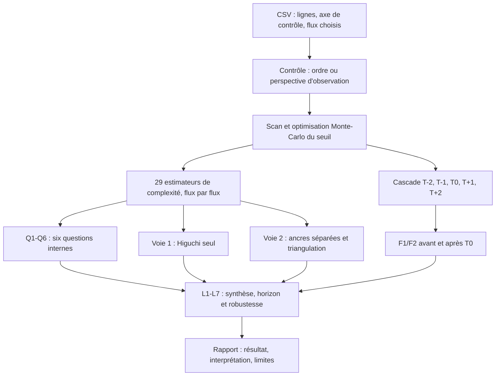

# Comprendre une sortie UNIVERSAL_LOG : guide de lecture

Ce guide explique les sorties en langage courant. Une valeur calculée décrit ce que le code a mesuré; son nom ne garantit pas qu'elle possède déjà le sens physique suggéré. Les libellés **résultat**, **hypothèse**, **choix de code** et **indisponible** doivent rester séparés.

## Le trajet de l'information

Le **flux** est une mesure présente dans le CSV. Le **contrôle** choisit l'axe utilisé pour ordonner ou observer les lignes. Changer le contrôle change la coupe du problème; ce n'est pas forcément un simple changement d'unité. Deux colonnes issues de la même formule ou de la même simulation ne sont pas deux confirmations indépendantes.

Dans le test Ising, chaque fichier d'entrée du pipeline est une série résumée de 76 températures pour une taille L; ce ne sont pas des trajectoires brutes de spins. Le CSV physique est produit par une simulation 2D de Wolff, avec 3 chaînes, 4 000 mesures et 500 mises à jour de chauffe par chaîne/température, puis des intervalles bootstrap à 95 % fondés sur 500 réplications pour les marqueurs. Le `n=76` utilisé dans les couches géométriques est le nombre de lignes analysées, pas le nombre de spins `L²`.

Un utilisateur peut aussi choisir la même colonne comme cible et comme contrôle si cette lecture répond à son besoin. Le pipeline doit alors signaler explicitement le cas diagonal. Certains scores deviennent tautologiques ou spécifiques à ce choix; ils ne doivent pas être comparés sans réserve aux runs où cible et contrôle diffèrent. Dans le benchmark Ising principal, la cible est l'énergie et les cinq contrôles sont Température, aimantation, χ, Cv et Binder; le cas diagonal énergie est un test de configuration séparé.

## Voie 1 et voie 2

| Voie | Ce qu'elle lit | Ce qu'il faut regarder | Ce qu'elle ne démontre pas seule |
|---|---|---|---|
| **Voie 1 : surface** | Higuchi comme estimateur unique | Valeur, stabilité au bruit, à l'échelle, au choix de flux et de contrôle | Toute la complexité du système. Higuchi est borné près de 1-2 dans son usage du code et ne peut donc pas, seul, donner une grande dimension de divergence. |
| **Voie 2 : triangulation** | Saturation, transition, divergence gardées séparément; contrepoids spectral/null et versions médianes/trio | Ancres individuelles, disponibilité des estimateurs, écarts, désaccords, sensibilité aux choix | Que la référence 4 ou le TLog fonctionne universellement. L'écart n'est pas automatiquement une cause ni un signal utile. |

La théorie dit de ne pas effacer le désaccord entre ancres par une moyenne unique. Il faut donc afficher la Voie 1 à côté de la Voie 2, puis demander dans quels cas elles convergent, se contredisent ou deviennent indisponibles.

## Les six questions (Q1-Q6)

| Question du code | Lecture simple | Précaution |
|---|---|---|
| **Q1 - Calme / chaos** | Taille d'effet entre la progression basse et haute pour chaque flux × estimateur. | Ce n'est pas un test mathématique de chaos. |
| **Q2 - Tension au seuil** | Taille d'effet entre des bandes avant et après le seuil. | Dépend du seuil et des marges choisies. |
| **Q3 - Agressivité** | Q1 restreint aux flux déclarés agressifs. | Peut recopier Q1 si la couverture est faible; le signaler. |
| **Q4 - Persistance** | Séparation du flux brut à l'intérieur des fenêtres, reportée avec les estimateurs. | Ce n'est pas l'exposant de Hurst. |
| **Q5 - Actif / réactif** | Contraste des moyennes brutes pour les flux étiquetés actifs et réactifs. | Si les étiquettes n'existent pas, certains zéros signifient « non calculé », pas absence d'effet. |
| **Q6 - Actif / réactif à l'échelle** | Variante de Q5 après division de chaque colonne par son écart-type, sans centrage. | C'est une question distincte; elle ne remplace pas Q5. |

Chaque graphique des six questions doit montrer le score **et son état** : calculé, non applicable, données insuffisantes ou erreur. Les zéros seuls sont ambigus.

## Seuils et dérivées F1/F2

La cascade affiche T-2, T-1, T0, T+1 et T+2 sur l'axe de progression du pipeline. Le T0 est d'abord une position sur cet axe. Sa conversion en température ou autre unité brute n'est sûre que si le contrôle est monotone et si la conversion est non ambiguë.

F1 et F2 résument une approximation quadratique séparément **avant** et **après** T0 : F1 est la pente au centre du segment; F2 est deux fois le coefficient quadratique, donc la courbure selon cette convention. Le rapport doit montrer les deux segments, leurs intervalles, le nombre de points, les éventuels élargissements, les signes et les différences post-pré. Ces coefficients sont descriptifs; ils ne prouvent pas une transition d'ordre physique.

## Trois Monte-Carlo différents à ne pas mélanger

1. **Simulation physique Ising :** les mises à jour Monte-Carlo de la grille de spins produisent les observations d'énergie, aimantation, susceptibilité, chaleur spécifique et Binder.
2. **Monte-Carlo interne au pipeline :** des configurations testent/optimisent les paramètres et positions du seuil selon la version. La graine, le nombre de tirages, la fonction de score et la valeur sélectionnée doivent figurer dans les traces.
3. **Permutations/bootstrap d'audit :** servent à construire des contrôles nuls ou des intervalles; ils ne sont pas l'optimiseur du pipeline.

La recherche dans la version v6.0 et les fichiers du projet n'a trouvé aucun algorithme explicitement nommé **Reverse Monte Carlo**. Renverser les lignes, permuter une cible ou tester des graines ne doit pas être renommé « Reverse Monte Carlo » : ce sont des contrôles d'ordre ou de stabilité. Un algorithme RMC formel demanderait sa propre définition et ses propres données.

## Mise en page recommandée pour une sortie accessible

1. **Première page :** réponse en une phrase, données utilisées, n, axe, cible, version, graine et avertissement sur l'interprétation.
2. **Vue générale :** un schéma des flux de calcul, puis un tableau par contrôle avec seuils, monotonie, Q1-Q6, L7a/L7b et statut.
3. **Figures lisibles :** courbe des observables brutes par rapport à l'axe; seuils tracés sur la même échelle avec la valeur de contrôle; panneaux F1/F2 pré/post; distributions ou points séparés par ancre Voie 2 et Higuchi Voie 1; petit panneau des résultats Monte-Carlo par graine.
4. **Chaque figure :** titre qui répond à une question, axes avec unités, n et taille L, légende textuelle, données absentes indiquées, mêmes couleurs d'une figure à l'autre. Ne pas utiliser rouge/vert seuls pour encoder un verdict.
5. **Annexe d'audit :** 29 estimateurs en table longue, JSON/CSV complets, commandes, dépendances, graines, journaux, hashes et choix de protocole.

Les graphiques doivent aider à voir les données et les désaccords, pas rendre un score heuristique plus convaincant qu'il ne l'est.
