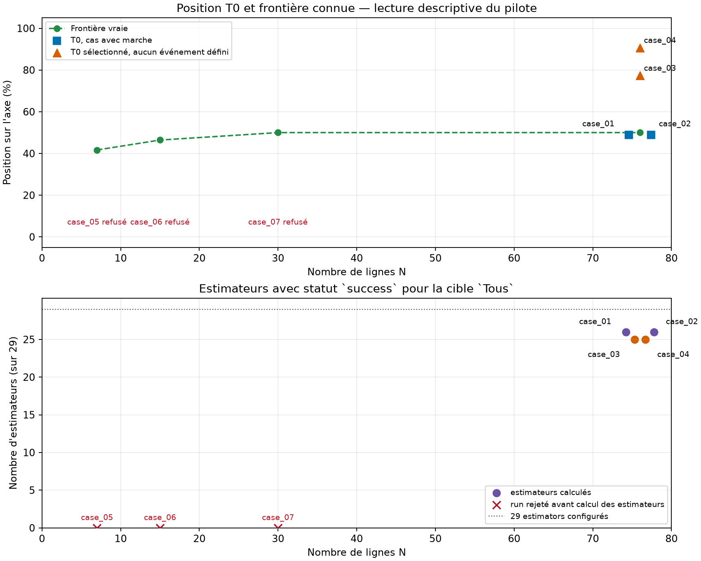

# Résultats du pilote synthétique v1

**Runs pipeline terminés :** 4/7; **erreurs explicitement enregistrées :** 3. **Axe et cible identiques dans la paire case_01/case_02 :** True.

Ce pilote comporte une réalisation déterministe par cas. Les chiffres ci-dessous décrivent ces exécutions; ils ne donnent pas de taux de détection ou de faux positifs.

## Résumé par cas

| Cas | N | Vérité | Statut | T0 rang % | Erreur normalisée | Estimateurs success / 29 | L7b | TLog classe |
|---|---:|---|---|---:|---:|---:|---|---|
| case_01 | 76 | marche | complete | 48.80 | 0.0120 | 26 / 29 | FRAGILE | {"saturation": -11.446431, "criticality": -7.048439, "divergence": -5.819824, "null_reference": -6.86011} |
| case_02 | 76 | marche | complete | 48.80 | 0.0120 | 26 / 29 | FRAGILE | {"saturation": -11.758414, "criticality": -6.754035, "divergence": -5.83956, "null_reference": -7.163464} |
| case_03 | 76 | aucun événement | complete | 77.31 | — | 25 / 29 | FRAGILE | {"saturation": -12.164058, "criticality": -6.245333, "divergence": -4.385632, "null_reference": -7.770223} |
| case_04 | 76 | aucun événement | complete | 90.66 | — | 25 / 29 | FRAGILE | {"saturation": -11.276259, "criticality": -5.699727, "divergence": -4.541989, "null_reference": -6.151813} |
| case_05 | 7 | marche | error | — | — | 0 / — | — | null |
| case_06 | 15 | marche | error | — | — | 0 / — | — | null |
| case_07 | 30 | marche | error | — | — | 0 / — | — | null |

## Disponibilité des six questions Q1–Q6

Chaque cellule indique les valeurs numériques finies / le nombre de valeurs numériques observées dans la sortie de la question. Ce sont des comptages de sorties, pas des scores de performance.

| Cas | Q1 | Q2 | Q3 | Q4 | Q5 | Q6 |
|---|---:|---:|---:|---:|---:|---:|
| case_01 | 116/116 | 116/116 | 58/58 | 116/116 | 116/116 | 103/116 |
| case_02 | 29/29 | 29/29 | 29/29 | 29/29 | 29/29 | 29/29 |
| case_03 | 87/87 | 87/87 | 58/58 | 87/87 | 87/87 | 75/87 |
| case_04 | 87/87 | 87/87 | 58/58 | 87/87 | 87/87 | 75/87 |
| case_05 | — | — | — | — | — | — |
| case_06 | — | — | — | — | — | — |
| case_07 | — | — | — | — | — | — |

## Cascade et dérivées F1/F2 rapportées par le pipeline

| Cas | F1 avant (T−1) | T0 | F1 après (T+1) | max F1 velocity | max F2 curvature | Statut |
|---|---:|---:|---:|---:|---:|---|
| case_01 | 44.6395 | 48.8031 | 55.9216 | 0.0900 | 0.0121 | ok |
| case_02 | 44.6395 | 48.8031 | 55.9216 | 0.0900 | 0.0121 | ok |
| case_03 | 71.9669 | 77.3065 | 82.6462 | 0.1088 | 0.0266 | ok |
| case_04 | 11.7102 | 90.6556 | 93.6556 | 0.0213 | 0.0050 | ok |
| case_05 | — | — | — | — | — | non calculé (entrée refusée) |
| case_06 | — | — | — | — | — | non calculé (entrée refusée) |
| case_07 | — | — | — | — | — | non calculé (entrée refusée) |

Ces F1/F2 sont les lectures numériques du code aux positions de la cascade; elles ne portent pas d'intervalle d'incertitude dans ce pilote.

## TLog et voies

| Cas | TLog saturation | TLog criticality | TLog divergence | TLog null | Higuchi Voie 1 | Voie 2 |
|---|---:|---:|---:|---:|---:|---|
| case_01 | -11.446 | -7.048 | -5.820 | -6.860 | 2.010 | heuristique, pas preuve |
| case_02 | -11.758 | -6.754 | -5.840 | -7.163 | 2.010 | heuristique, pas preuve |
| case_03 | -12.164 | -6.245 | -4.386 | -7.770 | 1.924 | heuristique, pas preuve |
| case_04 | -11.276 | -5.700 | -4.542 | -6.152 | 2.003 | heuristique, pas preuve |
| case_05 | — | — | — | — | — | non calculé |
| case_06 | — | — | — | — | — | non calculé |
| case_07 | — | — | — | — | — | non calculé |

Portée indiquée par v6.0 : `(d−4)·log(n)` sur la couche géométrique; les estimateurs bruts et les sorties par classe restent nécessaires à l'interprétation. La Voie 1 correspond ici à Higuchi; la Voie 2 reste une triangulation heuristique, pas une preuve.

## Interprétation et limites

- L'ablation des flux case_01/case_02 conserve exactement le même axe et la même cible : `True`. L'écart absolu de T0 est 0.0 points de pourcentage. Une seule paire donne une observation descriptive, sans incertitude estimable.
- Les comptes de valeurs Q suivent le nombre de flux disponibles : case_01 contient {"finite": 116, "numeric": 116} pour Q1 contre {"finite": 29, "numeric": 29} en cible seule. Les médianes de classe TLog changent aussi; deltas case_01 moins case_02 : `{"saturation": 0.3119829999999997, "criticality": -0.2944040000000001, "divergence": 0.019735999999999976, "null_reference": 0.30335400000000057}`. Cela montre des sorties de couche différentes dans cette paire malgré un T0 égal; ce n'est pas une mesure d'effet générale.
- Les cas AR(1) stationnaire et dérive lisse n'ont pas de frontière vraie. Si un T0 apparaît, il s'agit d'une position sélectionnée par le balayage; sans règle d'alerte gelée, ce résultat n'est pas noté faux positif.
- Rejets enregistrés : case_05 (N=7): ValueError('Série trop courte : 7 points valides. Au moins 50 sont requis avec la configuration actuelle.'); case_06 (N=15): ValueError('Série trop courte : 15 points valides. Au moins 50 sont requis avec la configuration actuelle.'); case_07 (N=30): ValueError('Série trop courte : 30 points valides. Au moins 50 sont requis avec la configuration actuelle.')
- Les compteurs `success` comptent les statuts de la cible `Tous` pour les estimateurs configurés. Ils ne signifient pas que chaque estimateur est valide ou fiable pour N court.
- Les sorties complètes, graphiques, journaux, manifestes, scores Q, dérivées F1/F2, Voie 1/2, TLog et L7a/L7b restent dans les sous-dossiers `runs/case_XX/`.
- Une exécution par cas ne permet ni intervalle de confiance ni généralisation. Aucune conclusion clinique, biologique ou universelle ne découle de ce pilote.

## Hypothèses et résultats observés

Les hypothèses génératrices sont dans `truth_private/truth.json`, séparées des CSV vus par le pipeline. Les résultats calculés sont dans `scored_pilot_results.json` et les données maîtres de chaque exécution dans `runs/case_XX/master_results.json`.
