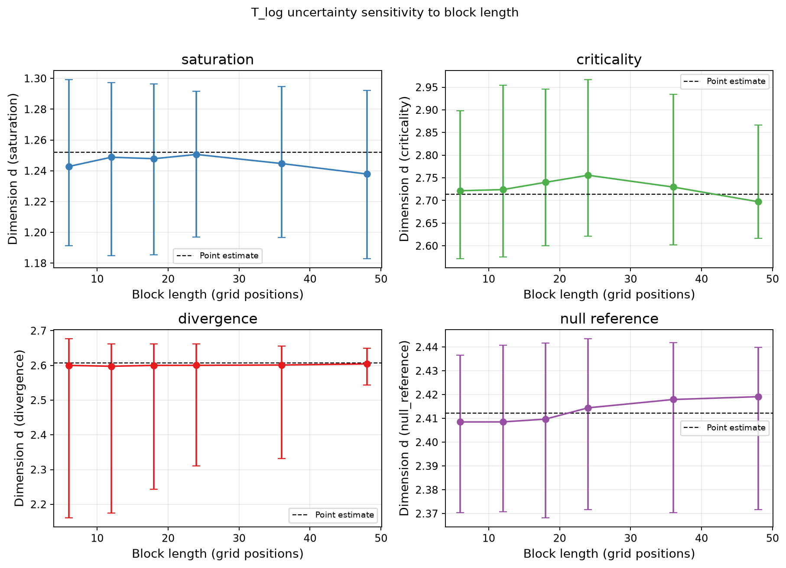

# Sensibilité de l’incertitude de `T_log` — essai Ising classique

## Question et portée

Cet essai vérifie si les intervalles bootstrap de la dimension `d` (et donc de `T_log = (d - 4) log(n)`) changent beaucoup quand on modifie la longueur des blocs. Il utilise les 120 positions de progression du paysage calculé par le pipeline pour le balayage Ising `L=16` (105 observations). Les 500 réplications rééchantillonnent des blocs mobiles sur ces positions ordonnées. `n` reste fixé; deux échelles ont été enregistrées dans l’essai d’intégration : 105 observations et 256 sites du réseau.

Cette analyse évalue la stabilité des intervalles selon le choix des blocs. Elle n’est ni une estimation indépendante de la température critique `Tc`, ni une validation physique des 29 estimateurs.

## Résultats de sensibilité

La longueur par défaut projetée de la fenêtre d’analyse est 24 positions. Les autres longueurs testées sont 6, 12, 18, 36 et 48 positions. Le tableau donne, pour chaque ancre, la médiane bootstrap de `d` et la largeur totale de son IC à 95 %.

| Longueur de bloc | Saturation : médiane (largeur IC) | Criticalité : médiane (largeur IC) | Divergence : médiane (largeur IC) | Référence nulle : médiane (largeur IC) |
|---:|---:|---:|---:|---:|
| 6  | 1,2428 (0,1080) | 2,7215 (0,3265) | 2,6001 (0,5164) | 2,4085 (0,0662) |
| 12 | 1,2488 (0,1124) | 2,7241 (0,3794) | 2,5976 (0,4869) | 2,4085 (0,0699) |
| 18 | 1,2478 (0,1110) | 2,7401 (0,3457) | 2,6001 (0,4187) | 2,4097 (0,0735) |
| 24 | 1,2506 (0,0949) | 2,7558 (0,3463) | 2,6003 (0,3512) | 2,4144 (0,0718) |
| 36 | 1,2447 (0,0981) | 2,7297 (0,3325) | 2,6012 (0,3247) | 2,4179 (0,0716) |
| 48 | 1,2379 (0,1095) | 2,6972 (0,2498) | 2,6043 (0,1066) | 2,4191 (0,0683) |

- Les médianes de `d` restent relativement proches pour les ancres saturation, divergence et référence nulle. L’ancre criticalité fluctue davantage, mais son intervalle reste de largeur notable à toutes les longueurs.
- La largeur des intervalles saturation et référence nulle est assez stable dans cette plage.
- L’incertitude de l’ancre divergence dépend fortement de la longueur choisie : son IC passe de 0,5164 à 0,1066. Cette contraction n’établit pas que le bloc 48 est meilleur; elle montre que la conclusion dépend du réglage et qu’il faut un critère de choix appuyé sur les données temporelles.
- `T_log` transforme ces incertitudes par le facteur fixe `log(n)`. Les valeurs pour `n=105` et `n=256` ne doivent donc pas être confondues, même si elles utilisent le même `d`.



## Comparaison contrôlée de chaînes indépendantes

Pour chaque chaîne `L=16`, les 50 blocs de 80 mises à jour de Wolff sont tous utilisés pour calculer une moyenne à chacune des 76 températures. Chaque ligne représente donc une température distincte : 76 points par chaîne, issus de 3 800 mesures de blocs. Il ne s’agit pas d’une trajectoire temporelle brute.

Le protocole utilise la même fenêtre fixe (`w_size=12`) et la même graine pipeline pour les trois chaînes; l’optimisation Monte Carlo de la fenêtre est désactivée. Le bootstrap de 300 réplications emploie une longueur mobile de 19 positions dans le paysage de 120 positions. Les valeurs ci-dessous utilisent `n=256` sites pour garder la même échelle physique entre chaînes. L’écart-type entre chaînes est descriptif sur trois chaînes, pas un intervalle calibré.

| Ancre | `d` moyen (ET entre chaînes) | Étendue de `d` | `T_log` à `n=256` calculé depuis le `d` moyen |
|---|---:|---:|---:|
| Saturation | 1,1004 (0,0079) | 1,0941–1,1093 | -16,0788 |
| Criticalité | 1,9592 (0,0182) | 1,9447–1,9796 | -11,3167 |
| Divergence | 2,5282 (0,0117) | 2,5146–2,5352 | -8,1616 |
| Référence nulle | 2,2314 (0,0200) | 2,2199–2,2545 | -9,8070 |

Les ancrages sont stables entre les trois chaînes avec ce protocole. L’ancre nommée `criticality` est ici autour de `1,96`, loin de la constante de référence `4`; le nom de la classe n’implique donc pas que sa sortie converge vers 4. Les signes négatifs de `T_log` découlent des `d<4` dans cette coupe; ils ne localisent pas `Tc` et ne valident pas une transition.

Le premier pilote, qui sélectionnait quatre blocs par température et optimisait chaque fenêtre séparément, est conservé dans `tlog_chain_comparison/` comme historique exploratoire. Ses valeurs ne sont pas comparables au présent protocole et ne sont pas utilisées pour la conclusion contrôlée.

Résultats complets, IC par chaîne et profils multi-échelles : `tlog_chain_comparison_controlled/tlog_chain_comparison_controlled.json` et `.csv`.

## Limites

Le bootstrap des sensibilités porte sur les positions de progression déjà produites par le pipeline, et non sur des séries brutes de spins. Il ne couvre pas les biais des estimateurs, le prétraitement, l’incertitude de `n`, ni l’incertitude du choix de longueur de bloc. Le bootstrap des profils contrôlés ne propage pas l’incertitude interne des 50 blocs dans chaque moyenne de température; seule la dispersion descriptive de trois chaînes est donnée. La validation Binder FSS avec bootstrap par chaîne/bloc est un résultat physique distinct, non une mesure de variance entre chaînes de `T_log`.

## Reproduction et fichiers

```powershell
.\.venv\Scripts\python.exe .\ising_classique_test\tlog_block_sensitivity.py
.\.venv\Scripts\python.exe .\ising_classique_test\tlog_independent_chains_controlled.py
```

- Données détaillées et métadonnées : `tlog_block_sensitivity.json`
- Résultats par ancre, estimateur, échelle et longueur de bloc : `tlog_block_sensitivity.csv`
- Script : `ising_classique_test/tlog_block_sensitivity.py`
- Étude physique Binder indépendante : `physical_validation_report.md`
