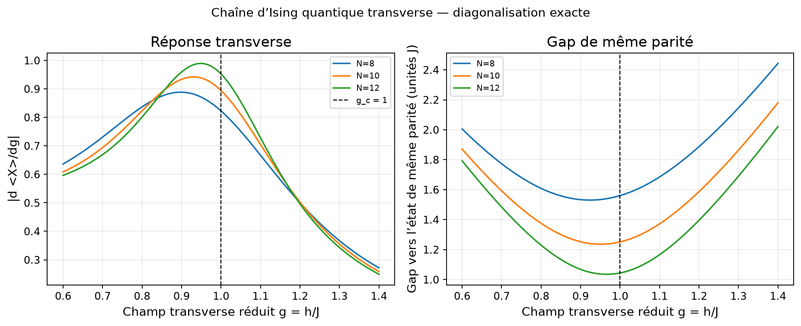

# Test du pipeline sur l’Ising quantique transverse

## Question

Vérifier que `UNIVERSAL_LOG_v5_3.py` peut traiter un second type de données physiques : une chaîne quantique dont l’état fondamental varie avec un champ transverse `g`. Ce test vérifie le transfert du pipeline et sa traçabilité; il ne démontre pas l’universalité de `T_log`.

## Modèle et référence physique

Le modèle utilisé est

```text
H/J = -Σᵢ Zᵢ Zᵢ₊₁ - g Σᵢ Xᵢ,   g = h/J,
```

sur un anneau périodique, à température nulle. Les chaînes de taille `N=8, 10, 12` sont résolues par diagonalisation creuse exacte des six plus faibles états propres, sur 81 valeurs de `g` entre 0,60 et 1,40. Pour cette convention Pauli et dans la limite thermodynamique, la référence critique est `g_c=1`. La solution de la chaîne transverse et la fermeture du gap critique remontent notamment à [Pfeuty (1970)](https://doi.org/10.1016/0003-4916(70)90270-8).

Les mesures sont l’énergie par site, l’aimantation transverse `⟨X⟩`, la corrélation longitudinale voisine `⟨ZᵢZᵢ₊₁⟩`, le gap et la réponse `|d⟨X⟩/dg|`. La parité globale `∏ᵢXᵢ` est utilisée pour distinguer le doublet de basse énergie du gap vers le premier état de même parité.

## Résultats physiques de taille finie

| Taille `N` | Pic de `|d⟨X⟩/dg|` | Minimum du gap de même parité | Minimum du gap spectral brut |
|---:|---:|---:|---:|
| 8  | 0,90 | `g=0,92` (1,531 `J`) | `g=0,60` (0,00588 `J`) |
| 10 | 0,93 | `g=0,95` (1,236 `J`) | `g=0,60` (0,00186 `J`) |
| 12 | 0,95 | `g=0,97` (1,035 `J`) | `g=0,60` (0,00060 `J`) |

Le pic de réponse et le minimum du gap de même parité se rapprochent de `g_c=1` quand `N` augmente, sur cette grille. Le minimum du gap spectral brut à `g=0,60` est le dédoublement tunnel entre les deux états de parité opposée dans le régime ordonné fini; le prendre seul pour localiser la transition serait trompeur.



## Exécution de `UNIVERSAL_LOG`

La même configuration a été utilisée pour les trois tailles : contrôle `g`, cible `transverse_magnetization`, fenêtre fixe 16, graine 20261107, 300 réplications bootstrap, optimisation Monte Carlo du seuil désactivée. Les 29 estimateurs ont été demandés; 18 des 21 sorties dimensionnelles admises par v5.3 étaient finies dans chaque taille.

| `N` | `d_sat` | `d_crit` | `d_div` | `d_null` | `T_log` à `n=N`, saturation / criticalité / divergence / référence nulle |
|---:|---:|---:|---:|---:|---|
| 8  | 1,0274 | 0,9784 | 1,6197 | 1,7573 | -6,181 / -6,283 / -4,950 / -4,664 |
| 10 | 1,0274 | 0,9614 | 1,5818 | 1,7580 | -6,845 / -6,997 / -5,568 / -5,162 |
| 12 | 1,0274 | 0,9645 | 1,5636 | 1,7586 | -7,387 / -7,543 / -6,054 / -5,570 |

Ces `d` résument la forme globale des courbes en fonction de `g`. L’ancre appelée `criticality` reste près de `0,96`, très loin de la référence `4`; toutes les valeurs de `T_log` sont négatives. Le pipeline n’a donc pas localisé `g_c` avec ces ancres. La localisation proche de 1 vient des observables physiques séparées. C’est un résultat utile : l’intégration fonctionne, mais la lecture actuelle des ancres ne doit pas être présentée comme détecteur validé de transition quantique.

La valeur de `T_log` change quand on change l’étiquette de `n`: les JSON conservent séparément `n=81` points de champ et `n=N` sites du réseau. Elles ne sont pas interchangeables.

## Limites et portée

- Ce sont des courbes d’état fondamental, pas des séries temporelles ni des trajectoires Monte Carlo.
- `N≤12` reste un petit système fini; le champ est échantillonné sur une grille de pas 0,01.
- La référence `g_c=1` est thermodynamique; les pics présentés sont des diagnostics de grille finie.
- Les étiquettes et `d` de `UNIVERSAL_LOG` demeurent heuristiques. Ce test vérifie l’API, le calcul des 29 indicateurs et l’enregistrement multi-échelle, pas leur interprétation physique universelle.

## Reproduction et artefacts

```powershell
.\.venv\Scripts\python.exe .\ising_quantique_test\run_tfim_exact_pipeline.py
```

- Générateur et lancement du pipeline : `run_tfim_exact_pipeline.py`
- Données par taille : `data/tfim_ground_state_N8.csv`, `N10.csv`, `N12.csv`
- Résultats complets : `quantum_ising_pipeline_summary.json` et `.csv`
- Observables physiques : `physical_finite_size_summary.csv` et `tfim_physical_diagnostics.png`
- Résultats `df_feat` et profils `T_log` par taille : `results/N8`, `results/N10`, `results/N12`
- Guide pour les nouveaux utilisateurs : [Guide débutant Universal Log](../GUIDE_DEBUTANT_UNIVERSAL_LOG.md)
