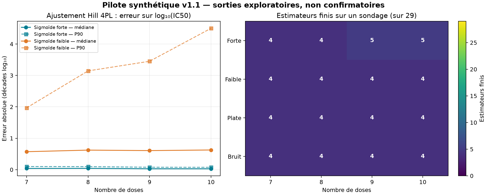

# Addendum — pilote synthétique des courbes dose-réponse courtes

**Date :** 21 novembre 2026  
**Protocole :** v1.1, descriptif et non confirmatoire  
**Source pipeline :** v6.0.0 inchangée, SHA-256 `bb8bbdba4eb1f8c55b49748274ae8fbfef8a43f6c1b890964f18ba77960c0773`

## But et portée

Ce pilote fait suite au gate d'entrée des 150 colonnes dose-réponse PDO de la Figure 6d, toutes rejetées par le seuil actuel de 50 observations. Il caractérise les estimateurs sur de petites séries synthétiques et vérifie le comportement d'un ajustement dose-réponse de référence. Il ne modifie pas UNIVERSAL_LOG et ne constitue pas un run complet du pipeline.

Le plan a été ramené de 800 appels aux 29 estimateurs à 16 après qu'une première exécution, interrompue avant écriture des résultats, a montré un coût CPU disproportionné. Les 800 ajustements Hill prévus dans le protocole v1.1 ont été conservés; les 29 estimateurs ont été sondés une seule fois par longueur et scénario. L'arrêt initial est conservé dans `COURBES_COURTES_SYNTHETIQUES_V1/ATTEMPT_LOG.md`.

## Protocole exécuté

Quatre grilles de 7, 8, 9 ou 10 doses logarithmiques entre `10^-9` et `10^-4` M ont été simulées dans quatre scénarios : une sigmoïde forte (100→20 %, pente 1,5, bruit SD 3 points), une sigmoïde faible (100→70 %, pente 0,8, bruit SD 10), un nul plat autour de 100 % (SD 5) et un bruit sans tendance autour de 50 % (SD 20). Chaque combinaison avait 50 réalisations Monte-Carlo, graine initiale `20261121`.

La référence conventionnelle est un ajustement Hill à quatre paramètres par `scipy.optimize.curve_fit`. Pour les 16 premières réalisations, la série réponse seule a aussi été transmise à `apply_complexity` du vrai fichier v6.0.0, avec `min_len=N` et `estimator_profile='all'`. Cette surcharge locale sonde uniquement les estimateurs; elle ne lève pas le seuil du run complet. Les concentrations ne sont pas fournies à cette fonction.

## Résultats

| N doses | Sigmoïde forte : erreur médiane / P90 log10(IC50) | Ajustements dans la plage | Sigmoïde faible : erreur médiane / P90 | Ajustements dans la plage | Nul plat : fit dans la plage sans IC50 vraie |
|---:|---:|---:|---:|---:|---:|
| 7 | 0,039 / 0,099 | 50/50 | 0,572 / 1,968 | 45/50 | 35/50 |
| 8 | 0,042 / 0,096 | 50/50 | 0,622 / 3,144 | 41/50 | 37/50 |
| 9 | 0,028 / 0,077 | 50/50 | 0,607 / 3,451 | 41/50 | 40/50 |
| 10 | 0,028 / 0,074 | 50/50 | 0,626 / 4,500 | 39/50 | 39/50 |



Le 4PL a convergé dans les 50/50 cas de chaque scénario; une covariance finie a aussi été rapportée dans ces exécutions. Pourtant, pour le nul plat et le bruit sans tendance, le fit retourne une IC50 dans la plage testée dans respectivement 35–40/50 et 34–43/50 cas. Cette valeur n'a pas de vérité correspondante : il n'existe pas d'IC50 génératrice dans ces groupes. Une convergence informatique ou une covariance finie n'établit donc pas l'identifiabilité biologique.

Dans chacun des 16 sondages, seuls DFA, Katz, Petrosian et Sevcik étaient finis, sauf la sigmoïde forte à N=9 et 10 où SampleEn était également fini. Cela fait 4 ou 5 valeurs finies sur 29. Avec un seul sondage par condition, on ne mesure ni stabilité entre répétitions, ni biais, ni précision des estimateurs.

Le run a pris 301,3 secondes sur l'environnement local. Cette durée est rapportée comme observation de cette exécution, pas comme benchmark portable.

## Interprétation permise et décisions

Le scénario sigmoïde forte est favorable par construction : grande amplitude, faible bruit et IC50 au milieu de la gamme. Sa bonne erreur médiane montre que le générateur et le fit de référence fonctionnent dans ce cas choisi. Le scénario faible/bruité montre une incertitude bien plus élevée, avec un P90 allant jusqu'à 4,5 décades. Les résultats ne sont pas une estimation de la performance sur une population de courbes biologiques.

**Décision pipeline :** ne pas abaisser le seuil de longueur de production ni implémenter une règle « 1 000 bootstraps / persistance 95 % » sur la base de ce pilote. Les répétitions simulées ici ne sont pas des expériences biologiques indépendantes. Un éventuel module dose-réponse doit utiliser explicitement dose, réplicats, modèle et contrôles; rapporter l'identifiabilité, les diagnostics d'ajustement et l'incertitude; prévoir l'abstention. T0 et TLog ne sont pas calculés ici; aucune équivalence `T0 = IC50` n'est testée.

## Précision pharmacologique sur KCNN4

La correction de cible proposée est pertinente au niveau de l'identité pharmacologique : KCNN4 code KCa3.1/Gardos, tandis que Kv1.3 est un autre canal. TRAM-34 est un inhibiteur de référence utilisé comme outil pharmacologique de laboratoire pour KCa3.1. Senicapoc/ICA-17043 a également atteint une étude de phase III dans la drépanocytose; cette expérience clinique n'en fait ni un médicament anticancéreux validé, ni un traitement du PDAC. Le programme de phase III a été arrêté après la recommandation du comité de surveillance en raison de la faible probabilité d'atteindre le critère primaire de réduction des crises douloureuses.

Le contexte du canal dans le PDAC doit lui aussi rester une hypothèse mécanistique issue d'études propres au modèle. Aucune preuve auditée ici ne démontre que Senicapoc ou TRAM-34 améliore la paire MRTX1133–olaparib, ni l'ADC anti-MUC1-C, dans un modèle PDAC. Il faut vérifier le composé, la cible fonctionnelle, l'expression/localisation KCNN4 et l'effet pharmacodynamique dans le système précis avant d'inclure un agent dans un protocole de combinaison.

Références pharmacologiques : [étude primaire TRAM-34/KCa3.1](https://pmc.ncbi.nlm.nih.gov/articles/PMC6672279/); [résultats de l'essai européen de phase III ICA-17043](https://www.clinicaltrialsregister.eu/ctr-search/trial/2004-004617-42/results); [annonce réglementaire de l'arrêt de l'essai ASSERT](https://www.sec.gov/Archives/edgar/data/902622/000119312507074426/dex991.htm); [étude de l'axe KCNN4/KCa3.1 dans le PDAC](https://www.nature.com/articles/s41401-021-00688-3).

## Reproduction et artefacts

Depuis la racine du projet :

```powershell
$pilot = ".\pancréas\ANALYSE_THERAPEUTIQUE_2026-11-21\AUDIT_RECOMMANDATIONS_PETITES_COHORTES\COURBES_COURTES_SYNTHETIQUES_V1"
.\.venv\Scripts\python.exe "$pilot\run_short_curve_pilot.py"
.\.venv\Scripts\python.exe "$pilot\summarize_short_curve_pilot.py"
```

Les entrées synthétiques, résultats Hill par réalisation, sondages des estimateurs, figures, manifeste et empreintes se trouvent dans `COURBES_COURTES_SYNTHETIQUES_V1/outputs/`. Aucun fichier source tiers n'est requis pour ce pilote.
