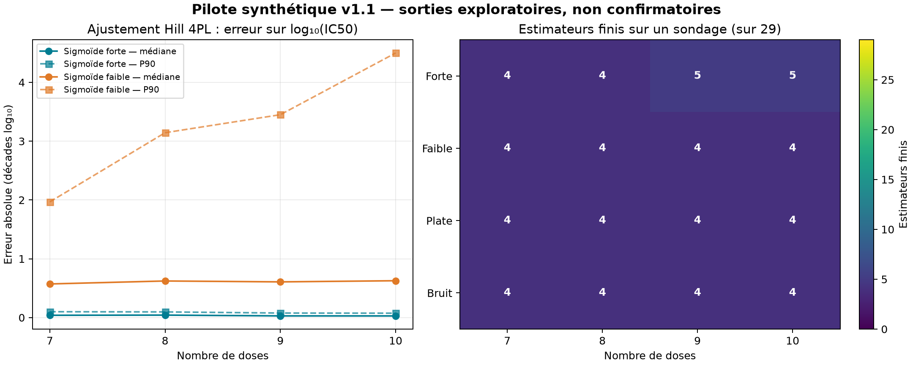

# Résultats — courbes dose-réponse courtes synthétiques v1.1

**Statut :** pilote descriptif Monte-Carlo, non confirmatoire. Exécution avec le `.venv`; source v6.0.0 non modifiée. Voir `PROTOCOLE_FR.md`, `ATTEMPT_LOG.md` et `outputs/PILOT_MANIFEST.json`.

## Résultats observés

- 800 courbes synthétiques ont été générées (50 par longueur × scénario; N=7, 8, 9, 10).
- Les 29 estimateurs ont été sondés sur 16 courbes représentatives (une par longueur × scénario), soit 464 lignes de sorties. Cela ne mesure pas leur stabilité entre répétitions.
- Le run a duré 301.3 secondes sur cette machine, essentiellement dans les 800 ajustements Hill, notamment sur les scénarios nuls.
- Chaque sondage donne seulement 4/29 estimateurs finis, sauf la sigmoïde forte à N=9 et N=10 (5/29). Les quatre constamment finis ici sont DFA, Katz, Petrosian et Sevcik; SampleEn apparaît en plus dans les deux sondages sigmoïdes fortes les plus longs.
- Les 50/50 ajustements convergent dans chaque groupe et les matrices de covariance renvoyées sont finies dans ces exécutions. Cette convergence ne suffit pas à établir qu'une IC50 existe ou est identifiable.

### Erreur IC50 du fit Hill 4PL

| N doses | Sigmoïde forte : erreur médiane / P90 (décades) | IC50 dans la plage | Sigmoïde faible : erreur médiane / P90 (décades) | IC50 dans la plage | Nul plat : fit dans la plage (IC50 inexistante) |
|---:|---:|---:|---:|---:|---:|
| 7 | 0.039 / 0.099 | 50/50 | 0.572 / 1.968 | 45/50 | 35/50 |
| 8 | 0.042 / 0.096 | 50/50 | 0.622 / 3.144 | 41/50 | 37/50 |
| 9 | 0.028 / 0.077 | 50/50 | 0.607 / 3.451 | 41/50 | 40/50 |
| 10 | 0.028 / 0.074 | 50/50 | 0.626 / 4.500 | 39/50 | 39/50 |

## Lecture méthodologique

Le scénario à réponse forte, avec IC50 au milieu de la gamme, grande amplitude et faible bruit, est favorable par construction : son erreur médiane reste entre 0,028 et 0,042 log10. Le scénario faible/bruité est nettement moins stable : son erreur médiane est de 0,57 à 0,63 log10 et son P90 atteint 1,97 à 4,50 log10. Ces valeurs caractérisent uniquement ces générateurs et cette grille de concentrations.

Surtout, le fit Hill converge aussi dans les scénarios sans IC50 vraie. Dans le nul plat, son IC50 est située dans la gamme testée dans 35–40 cas sur 50; dans le bruit sans tendance, dans 34–43 cas sur 50. Ce comportement est un avertissement sur la permissivité d'un fit convergé, pas un taux de faux positifs de T0. Un futur mode dose-réponse doit pouvoir déclarer la réponse non identifiable ou s'abstenir.

Les 29 estimateurs ne reçoivent ici que la série réponse, standardisée comme le fait `apply_complexity`; ils ne voient pas la concentration. Ce sont des estimateurs de séries, et leur valeur finie ne constitue pas une mesure validée d'IC50, d'inflexion ou d'entropie pharmacologique. Le fait que seulement 4–5 valeurs soient finies dans ces 16 sondages indique que le mode court requiert une étude méthode par méthode avant tout profil de production.

## Ce qui n'a pas été établi

- Aucun T0, TLog, Q1–Q6, F1/F2, Voie 1/2, L7a ou L7b n'a été calculé : le pipeline complet garde son seuil d'entrée de 50 points et les courbes courtes réelles sont refusées. Le seuil n'a pas été changé.
- Le test précédent sur les données réelles Figure 6d de Yin et al. a transmis séparément 150 colonnes de 7 ou 8 doses à la porte d'entrée réelle de v6.0.0 : les 150 ont été rejetées. Il s'agit d'un contrôle de compatibilité d'entrée, sans T0 ni résultat d'effet biologique (voir `../PDO_FIG6D_PIPELINE_GATE_SUMMARY.json`).
- Aucune équivalence T0=IC50, aucune corrélation entre ces quantités, aucune règle bootstrap à 95 % et aucune efficacité thérapeutique ne sont testées ou validées.
- Les Monte-Carlo synthétiques ne remplacent pas les réplicats par puits, expériences indépendantes, modèles biologiques ou contrôles de plaque.

## Fichiers de reproduction

- `run_short_curve_pilot.py` — générateur, fit 4PL, appel aux estimateurs et sortie des CSV.
- `outputs/SYNTHETIC_DOSE_CURVES.csv` — toutes les doses et réponses simulées.
- `outputs/HILL4_FIT_PER_CURVE.csv` et `HILL4_FIT_SUMMARY.csv` — résultats de chaque fit et synthèse.
- `outputs/ESTIMATOR_PROBES.csv` — sorties brutes des 29 estimateurs pour les 16 sondages.
- `outputs/PILOT_MANIFEST.json` — empreintes, versions, paramètres et durée.

**Décision :** ne pas activer un seuil de N=7–10 en production. Étape suivante : concevoir un module pharmacologique séparé qui exploite les coordonnées de dose, la réplication hiérarchique, la qualité d'ajustement/identifiabilité et une règle d'abstention pré-déclarée; ensuite seulement comparer à des courbes publiques réelles.
