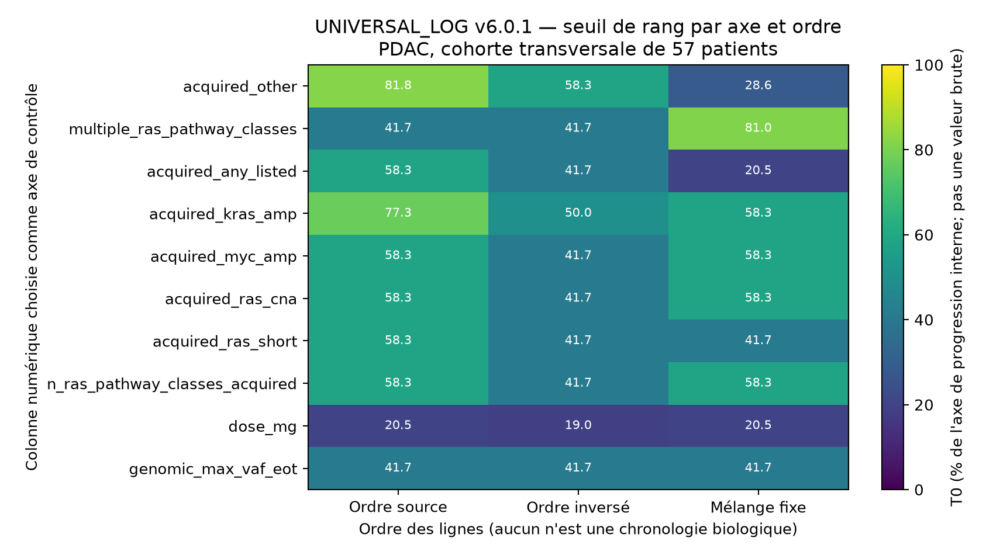
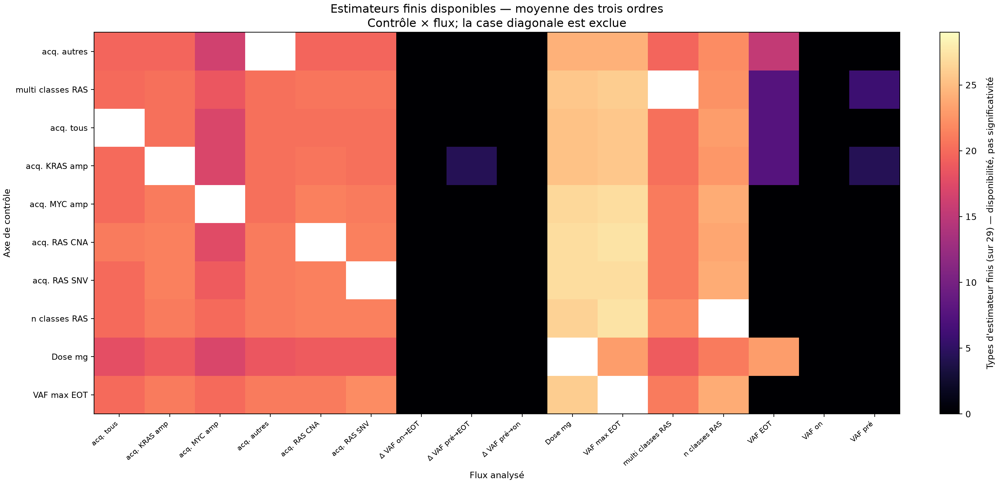

# Audit UNIVERSAL_LOG v6.0.1 — matrice contrôle × flux PDAC

**Date :** 21 novembre 2026  
**Statut :** balayage descriptif achevé; aucun résultat présenté comme prédiction, effet causal, biomarqueur validé ou efficacité thérapeutique.

## Question et portée

Cette analyse reprend le CSV patient de 57 sujets issu des tableaux cliniques publiés sur le daraxonrasib. Elle passe le cœur `run_pipeline` de v6.0.1 sur toutes ses colonnes numériques : une colonne à la fois comme axe de contrôle, puis toutes les autres colonnes numériques conservées comme flux distincts. L'axe sélectionné est exclu des flux de ce passage. Les contrôles non monotones ne sont pas rejetés.

Le tableau est transversal : une ligne = un patient. La cohorte assemblée réunit 44 patients d'une strate principale et 13 de la table supplémentaire à dose plus faible; la sélection concerne des patients ayant bénéficié initialement avant progression et ne comporte pas de groupe non-progressif comparateur. Les strates ne sont pas randomisées l'une par rapport à l'autre. L'ordre source regroupe donc les strates de dose; l'ordre inversé et le mélange déterministe servent uniquement à vérifier la sensibilité à l'ordre des lignes. Aucun ordre de patients n'est une chronologie biologique. Source primaire : Aronchik et al., *Nature Medicine* (2026), [article et données supplémentaires](https://doi.org/10.1038/s41591-026-04537-w).

## Protocole exécuté

- Pipeline : `pancréas/ANALYSE_THERAPEUTIQUE_2026-11-20/REPLICATION_P2_010_GEO_2026-11-20/pipeline_source/UNIVERSAL_LOG_v6.0.1_control_flux_exclusion.py`, v6.0.1, SHA-256 `ce0557cb4c44c15a142291e5522b446f7212136686c3035c97f12a3d0e959086`.
- Entrée : `pancréas/ANALYSE_THERAPEUTIQUE_2026-11-17/multi_axis_resistance/results_all_57/patient_level_normalized_57.csv`, 57 lignes × 30 colonnes, 57 identifiants patient distincts, SHA-256 `fab60be3456617725efd541e7f7fa1ef3f0e8fc98cb4bf1fcafde7e23efd256b`.
- Mode `fast`, Cohen-d, graine `20261121`, un worker, triangulation complète désactivée.
- Minimum d'entrée inchangé : 50 valeurs valides dans l'axe. Pas d'imputation des VAF/deltas manquants.
- Toutes les colonnes numériques d'origine sont des candidats axes; les autres restent des flux. Les textes catégoriels et annotations libres ne sont pas convertis en nombres.
- Trois dispositions : ordre source, ordre inversé, mélange déterministe `20261121`.

## Résultats observés

La matrice comprend **48 passages** : **30 réussites**, **18 abstentions au minimum d'entrée**, **0 erreurs**. Dix axes numériques passent l'entrée dans les trois dispositions; six axes insuffisamment complets s'abstiennent.

### Seuils de rang par axe et ordre des lignes

Les nombres sont `T0` en pourcentage de l'axe de progression interne du pipeline, pas une valeur brute de dose ou de VAF.

| Axe numérique | Ordre source | Inversé | Mélange fixe | Étendue observée |
|---|---:|---:|---:|---:|
| `acquired_other` | 81.82 % | 58.33 % | 28.57 % | 53.25 points |
| `multiple_ras_pathway_classes` | 41.67 % | 41.67 % | 80.95 % | 39.29 points |
| `acquired_any_listed` | 58.33 % | 41.67 % | 20.45 % | 37.88 points |
| `acquired_kras_amp` | 77.27 % | 50.00 % | 58.33 % | 27.27 points |
| `acquired_myc_amp` | 58.33 % | 41.67 % | 58.33 % | 16.67 points |
| `acquired_ras_cna` | 58.33 % | 41.67 % | 58.33 % | 16.67 points |
| `acquired_ras_short` | 58.33 % | 41.67 % | 41.67 % | 16.67 points |
| `n_ras_pathway_classes_acquired` | 58.33 % | 41.67 % | 58.33 % | 16.67 points |
| `dose_mg` | 20.45 % | 19.05 % | 20.45 % | 1.41 points |
| `genomic_max_vaf_eot` | 41.67 % | 41.67 % | 41.67 % | 0.00 points |

La dispersion la plus élevée entre les trois ordres concerne `acquired_other` (53,25 points), puis `multiple_ras_pathway_classes` (39,29), `acquired_any_listed` (37,88) et `acquired_kras_amp` (27,27). `dose_mg` varie de 19,05 à 20,45 points de rang (étendue 1,41); `genomic_max_vaf_eot` reste à 41,67 dans ces trois ordres. Ce sont des observations sur un seul jeu et trois dispositions précises.



### Couverture réelle des estimateurs par flux

Le fait que le pipeline appelle 29 estimateurs ne signifie pas que 29 sorties finies sont disponibles pour chaque flux. Le tableau ci-dessous compte, pour chaque flux, le nombre moyen de types d'estimateur ayant au moins une valeur finie dans une matrice flux × contrôle × ordre. La disponibilité ne mesure ni significativité ni validité biologique.

| Flux | Paires contrôle × ordre | Estimateurs finis moyens (sur 29) | N observé min–max |
|---|---:|---:|---:|
| `delta_on_to_eot_vaf_pp` | 30 | 0.0 | 25–25 |
| `delta_pre_to_on_vaf_pp` | 30 | 0.0 | 25–25 |
| `ras_vaf_on` | 30 | 0.0 | 26–26 |
| `delta_pre_to_eot_vaf_pp` | 30 | 0.4 | 41–41 |
| `ras_vaf_pre` | 30 | 1.0 | 44–44 |
| `ras_vaf_eot` | 30 | 6.1 | 49–49 |
| `acquired_myc_amp` | 27 | 18.1 | 57–57 |
| `acquired_any_listed` | 27 | 19.9 | 57–57 |
| `acquired_other` | 27 | 20.4 | 57–57 |
| `acquired_kras_amp` | 27 | 20.6 | 57–57 |
| `acquired_ras_cna` | 27 | 20.6 | 57–57 |
| `multiple_ras_pathway_classes` | 27 | 20.6 | 57–57 |
| `acquired_ras_short` | 27 | 20.6 | 57–57 |
| `n_ras_pathway_classes_acquired` | 27 | 23.0 | 57–57 |
| `genomic_max_vaf_eot` | 27 | 25.9 | 57–57 |
| `dose_mg` | 27 | 26.0 | 57–57 |



Les flux `ras_vaf_pre`, `ras_vaf_on` et les trois deltas n'ont aucune valeur moyenne d'estimateur finie dans le run pilote `dose_mg`; `ras_vaf_eot` n'a que quelques valeurs finies dans ce run. Ils restent dans les matrices de flux avec leurs valeurs manquantes, sans être imputés. Les CSV d'audit donnent le détail de chaque paire, de chaque ordre et des indicateurs de monotonie.

### Contrôles mis en abstention

| Contrôle numérique candidat | N valide | Statut |
|---|---:|---|
| `ras_vaf_pre` | 44 | abstention : minimum 50 conservé |
| `ras_vaf_on` | 26 | abstention : minimum 50 conservé |
| `ras_vaf_eot` | 49 | abstention : minimum 50 conservé |
| `delta_pre_to_on_vaf_pp` | 25 | abstention : minimum 50 conservé |
| `delta_on_to_eot_vaf_pp` | 25 | abstention : minimum 50 conservé |
| `delta_pre_to_eot_vaf_pp` | 41 | abstention : minimum 50 conservé |

### Résumé complet des 48 passages

Chaque ligne correspond à un contrôle candidat dans une disposition des lignes. `T0 interne` est donné uniquement quand le pipeline a franchi son minimum de 50 valeurs; les lignes en abstention n'ont pas de seuil calculé. Les durées sont le temps observé pour chaque passage sur cet environnement.

| Ordre | Contrôle | Statut | N valide | T0 interne (%) | Flux analysés | Durée (s) |
|---|---|---|---:|---:|---:|---:|
| source_order | `dose_mg` | réussi | 57 | 20.45 | 15 | 56.3 |
| source_order | `ras_vaf_pre` | abstention N<50 | 44 | — | 0 | — |
| source_order | `ras_vaf_on` | abstention N<50 | 26 | — | 0 | — |
| source_order | `ras_vaf_eot` | abstention N<50 | 49 | — | 0 | — |
| source_order | `genomic_max_vaf_eot` | réussi | 57 | 41.67 | 15 | 75.2 |
| source_order | `acquired_ras_short` | réussi | 57 | 58.33 | 15 | 76.6 |
| source_order | `acquired_ras_cna` | réussi | 57 | 58.33 | 15 | 78.4 |
| source_order | `acquired_kras_amp` | réussi | 57 | 77.27 | 15 | 51.1 |
| source_order | `acquired_myc_amp` | réussi | 57 | 58.33 | 15 | 82.3 |
| source_order | `acquired_other` | réussi | 57 | 81.82 | 15 | 51.4 |
| source_order | `acquired_any_listed` | réussi | 57 | 58.33 | 15 | 81.9 |
| source_order | `n_ras_pathway_classes_acquired` | réussi | 57 | 58.33 | 15 | 75.9 |
| source_order | `multiple_ras_pathway_classes` | réussi | 57 | 41.67 | 15 | 76.5 |
| source_order | `delta_pre_to_on_vaf_pp` | abstention N<50 | 25 | — | 0 | — |
| source_order | `delta_on_to_eot_vaf_pp` | abstention N<50 | 25 | — | 0 | — |
| source_order | `delta_pre_to_eot_vaf_pp` | abstention N<50 | 41 | — | 0 | — |
| reverse_order | `dose_mg` | réussi | 57 | 19.05 | 15 | 50.6 |
| reverse_order | `ras_vaf_pre` | abstention N<50 | 44 | — | 0 | — |
| reverse_order | `ras_vaf_on` | abstention N<50 | 26 | — | 0 | — |
| reverse_order | `ras_vaf_eot` | abstention N<50 | 49 | — | 0 | — |
| reverse_order | `genomic_max_vaf_eot` | réussi | 57 | 41.67 | 15 | 75.1 |
| reverse_order | `acquired_ras_short` | réussi | 57 | 41.67 | 15 | 81.0 |
| reverse_order | `acquired_ras_cna` | réussi | 57 | 41.67 | 15 | 75.2 |
| reverse_order | `acquired_kras_amp` | réussi | 57 | 50.00 | 15 | 74.5 |
| reverse_order | `acquired_myc_amp` | réussi | 57 | 41.67 | 15 | 83.5 |
| reverse_order | `acquired_other` | réussi | 57 | 58.33 | 15 | 77.0 |
| reverse_order | `acquired_any_listed` | réussi | 57 | 41.67 | 15 | 78.9 |
| reverse_order | `n_ras_pathway_classes_acquired` | réussi | 57 | 41.67 | 15 | 78.7 |
| reverse_order | `multiple_ras_pathway_classes` | réussi | 57 | 41.67 | 15 | 79.4 |
| reverse_order | `delta_pre_to_on_vaf_pp` | abstention N<50 | 25 | — | 0 | — |
| reverse_order | `delta_on_to_eot_vaf_pp` | abstention N<50 | 25 | — | 0 | — |
| reverse_order | `delta_pre_to_eot_vaf_pp` | abstention N<50 | 41 | — | 0 | — |
| shuffle_20261121 | `dose_mg` | réussi | 57 | 20.45 | 15 | 57.8 |
| shuffle_20261121 | `ras_vaf_pre` | abstention N<50 | 44 | — | 0 | — |
| shuffle_20261121 | `ras_vaf_on` | abstention N<50 | 26 | — | 0 | — |
| shuffle_20261121 | `ras_vaf_eot` | abstention N<50 | 49 | — | 0 | — |
| shuffle_20261121 | `genomic_max_vaf_eot` | réussi | 57 | 41.67 | 15 | 76.6 |
| shuffle_20261121 | `acquired_ras_short` | réussi | 57 | 41.67 | 15 | 78.2 |
| shuffle_20261121 | `acquired_ras_cna` | réussi | 57 | 58.33 | 15 | 76.8 |
| shuffle_20261121 | `acquired_kras_amp` | réussi | 57 | 58.33 | 15 | 80.6 |
| shuffle_20261121 | `acquired_myc_amp` | réussi | 57 | 58.33 | 15 | 83.1 |
| shuffle_20261121 | `acquired_other` | réussi | 57 | 28.57 | 15 | 58.1 |
| shuffle_20261121 | `acquired_any_listed` | réussi | 57 | 20.45 | 15 | 55.8 |
| shuffle_20261121 | `n_ras_pathway_classes_acquired` | réussi | 57 | 58.33 | 15 | 78.4 |
| shuffle_20261121 | `multiple_ras_pathway_classes` | réussi | 57 | 80.95 | 15 | 48.5 |
| shuffle_20261121 | `delta_pre_to_on_vaf_pp` | abstention N<50 | 25 | — | 0 | — |
| shuffle_20261121 | `delta_on_to_eot_vaf_pp` | abstention N<50 | 25 | — | 0 | — |
| shuffle_20261121 | `delta_pre_to_eot_vaf_pp` | abstention N<50 | 41 | — | 0 | — |

## Lecture permise et limites

**Résultat établi :** v6.0.1 a exécuté la matrice numérique contrôle × flux sans erreur; le contrôle sélectionné est absent des flux mappés. Les seuils de rang dépendent de l'axe et, pour plusieurs colonnes, de l'ordre des lignes. Les flux à données clairsemées produisent peu ou pas d'estimateurs finis.

**Interprétation limitée :** l'ordre patient n'étant pas un temps mesuré, les différences entre source, inversion et mélange sont un diagnostic de dépendance à l'ordre dans un jeu transversal. Elles ne constituent pas une preuve de dynamique tumorale. Les sorties ne testent pas causalement un biomarqueur, ne prédisent pas la réponse d'un patient et ne démontrent pas l'efficacité du daraxonrasib.

**Hypothèse à tester ailleurs :** si certains axes produisent un motif stable et reproductible, il faut d'abord le retrouver dans une cohorte indépendante avec mesures datées/ordonnées pertinentes et unités biologiques confirmées. La présente matrice ne choisit pas un mécanisme ni un traitement.

## Fichiers et reproduction

- Script d'exécution : `run_patient_axis_flux_sweep.py`.
- Script de synthèse : `summarize_patient_axis_flux_sweep.py`.
- Tous les passages, contrôles et empreintes : `results/RUN_MANIFEST.json`, `results/RUN_SUMMARY.csv`.
- Détail contrôle × flux × estimateurs : `results/FLOW_ESTIMATOR_COVERAGE.csv`.
- Seuils par ordre : `results/AXIS_ORDER_SENSITIVITY.csv`.
- Rôle et monotonie des axes/flux : `results/AXIS_FLUX_ROLE_MONOTONICITY.csv`.
- Entrées exactes et sorties complètes compressées, journaux console et matrices `features.csv` : `results/runs/`.
- La source CSV et le code pipeline restent inchangés.

Depuis la racine du projet, `.venv` activé :

```powershell
.\.venv\Scripts\python.exe .\pancréas\ANALYSE_THERAPEUTIQUE_2026-11-21\UNIVERSAL_LOG_PDACPATIENT_AXE_FLUX_2026-11-21\run_patient_axis_flux_sweep.py
.\.venv\Scripts\python.exe .\pancréas\ANALYSE_THERAPEUTIQUE_2026-11-21\UNIVERSAL_LOG_PDACPATIENT_AXE_FLUX_2026-11-21\summarize_patient_axis_flux_sweep.py
```
