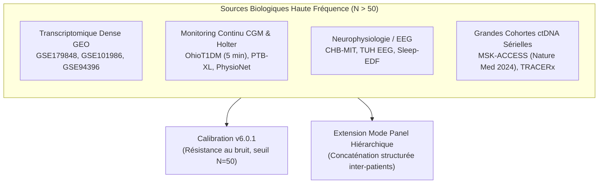
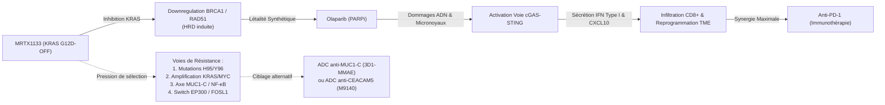
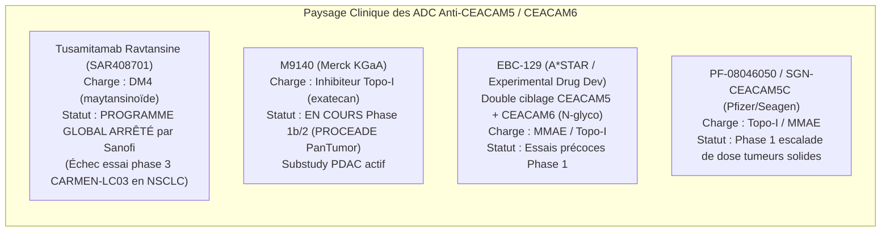
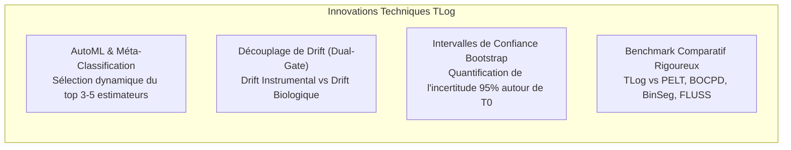
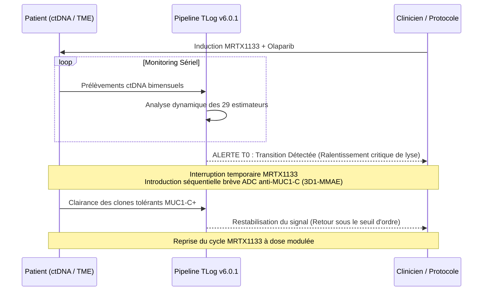
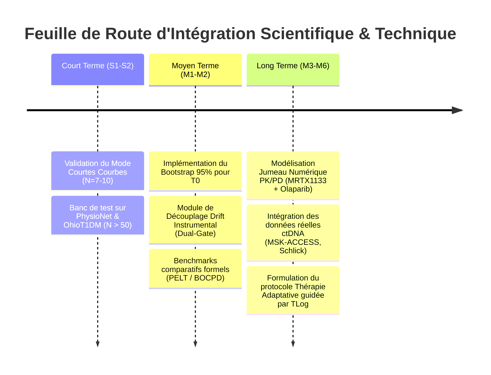

# RAPPORT DE RECHERCHE PROSPECTIVE — NOUVELLES IDÉES SCIENTIFIQUES ET TECHNIQUES
## Pipeline Universal Log v6.0.1 & Programme Cancer du Pancréas (PDAC)
**Document :** `IDEAS_NOUVELLES_V1_FR.md`  
**Date :** 23 novembre 2026  
**Auteur :** Worker `ideas` (Swarm Universal Log Research)  
**Destinataire :** `@coordinator`, Équipe de recherche Universal Log / PDAC  
**Dépôt de référence :** [https://github.com/FindPrint/universal-log-research](https://github.com/FindPrint/universal-log-research)  
**Statut :** Document d'orientation scientifique et technique — V1.0

---

## RÉSUMÉ EXÉCUTIF

Le projet **Universal Log** repose sur une promesse méthodologique majeure : détecter les transitions d'état critique dans des flux ordonnés et des séries temporelles biologiques complexes via le pipeline `TLog v6.0.1`. Dans le cadre du cancer de l'adénocarcinome canalaire pancréatique (PDAC), l'objectif prioritaire est de **devancer la rechute clinique** en identifiant les bifurcations sous-clonales sur des signaux circulants (ctDNA, marqueurs sanguins) plusieurs semaines à plusieurs mois avant l'imagerie conventionnelle (CT scan) et l'élévation tardive du CA19-9.

Ce document présente une synthèse approfondie d'exploration structurée en quatre volets :
1. **Nouvelles sources de données publiques :** Identification de jeux de données biologiques haute densité ($N > 50$ points temporels) issus de la transcriptomique dense (GEO GSE179848, GSE101986, GSE94396, GSE346894, GSE141017), de la neurophysiologie (CHB-MIT, TUH EEG, Sleep-EDF), du monitoring physiologique continu (CGM OhioT1DM, D1NAMO, Holter PTB-XL / MIT-BIH) et de grandes cohortes ctDNA longitudinales multi-prélèvements (MSK-ACCESS 2024, TRACERx 2023, Schlick 2022).
2. **Nouvelles idées scientifiques PDAC :** Cartographie précise de l'état de l'art sur la combinaison tri-thérapique **MRTX1133 + Olaparib + anti-PD-1** (synergie par létalité synthétique HRD induite et déploiement de lymphocytes CD8+ via cGAS-STING), les mécanismes de résistance émergents à MRTX1133 (mutations secondaires Switch-II H95/Y96, amplifications KRAS/MYC/YAP1, remodelage épigénétique EP300/FOSL1 sensible aux BETi, et boucle auto-inductive MUC1-C/NF-κB), la supériorité cinétique du ctDNA sur le CA19-9 (**lead time moyen de 2.8 à 4.6 mois vs 0 à 3 semaines**), et le statut des ADC ciblant CEACAM5 (M9140 en phase 1b/2, EBC-129, PF-08046050, suite à l'arrêt de tusamitamab ravtansine).
3. **Innovations techniques pour le pipeline TLog :** Proposition d'un méta-classifieur **AutoML** pour sélectionner dynamiquement le top 3-5 des estimateurs selon le régime de données, d'une architecture **Dual-Gate & Invariant Subspace Projection** pour découpler le drift instrumental du drift biologique, d'un module d'**intervalles de confiance bootstrap (MBB)** à 95% pour quantifier la netteté de $T_0$, et d'un benchmark comparatif formel opposant TLog aux méthodes de changepoint classiques (PELT, BOCPD, BinSeg, FLUSS).
4. **Idées originales à fort impact :** Formulation de 5 propositions inédites : (i) Jumeau numérique PK/PD couplé TLog pour la bascule clonale sous MRTX1133+Olaparib, (ii) Panel hiérarchique multimodal bayésien (ctDNA + miRNA exosomaux + cinétique CA19-9), (iii) Thérapie adaptative dynamique guidée par $T_0$ ("TLog-Guided Pulsing"), (iv) Sentinelle CGM pour la détection pré-symptomatique du diabète de type 3c induit par le PDAC, et (v) Cadre de stress-testing physique par injection systématique de bruit calibré.

---

# PARTIE 1 — NOUVELLES SOURCES DE DONNÉES PUBLIQUES

Le pipeline `UNIVERSAL_LOG_v6.0.1` impose un garde-fou fondamental : **$N \ge 50$ points temporels par flux** pour garantir la validité mathématique des estimateurs fractals et non linéaires (DFA, Hurst, exposants spectraux, entropie). Dans les essais cliniques oncologiques classiques, les prélèvements ctDNA sont limités à 3–8 points par patient. Pour valider, calibrer et tester les limites de l'algorithme, il est impératif d'exploiter des bases de données haute fréquence ou des cohortes d'extension denses.



---

### 1.1 Séries temporelles biologiques haute densité ($N > 50$)

#### A. Séries transcriptomiques longitudinales (RNA-seq / Microarray à haute résolution temporelle)
Bien que les prélèvements de tissus humains chez un même patient soient rares à $N > 50$, plusieurs séries denses in vitro, in vivo ou sur cellules mononucléées sanguines (PBMC) permettent de calibrer la dynamique non linéaire :
1. **NCBI GEO GSE179848 (Fibroblastes humains au cours du vieillissement réplicatif) :**
   * **Description :** Suivi transcriptomique longitudinal haute résolution de fibroblastes primaires humains ($n = 345$ profils RNA-seq complets) cartographiant la trajectoire continue de sénescence cellulaire sur plusieurs mois.
   * **Intérêt pour TLog :** Fournit une cinétique biologique non stationnaire continue sans choc artificiel, idéale pour tester si $T_0$ marque la transition de sénescence avant les marqueurs classiques (p16INK4a, p21).
2. **NCBI GEO GSE101986 (Dynamique développementale murine) :**
   * **Description :** Séries temporelles de séquençage d'ARN à travers 12 stades majeurs embryonnaires et post-nataux avec réplicats denses ($N > 60$ échantillons ordonnés).
   * **Intérêt pour TLog :** Permet d'analyser la robustesse des estimateurs spectraux lors de transitions phénotypiques programmées.
3. **NCBI GEO GSE94396 (Cinétique d'activation immunitaire des lymphocytes T régulateurs iTreg) :**
   * **Description :** Trajectoire transcriptomique haute densité de la différenciation des lymphocytes T sur de multiples points consécutifs rapprochés.
   * **Intérêt pour TLog :** Modélisation de la dépolarisation et de l'activation immunitaire, directement transposable à l'étude de l'épuisement des lymphocytes T CD8+ dans le microenvironnement tumoral sous traitement.

#### B. Neurophysiologie et EEG (PhysioNet) : Calibrage haute fréquence ($N = 10^3$ à $10^5$)
L'électroencéphalographie offre un banc d'essai idéal pour valider les estimateurs fractals (Katz, Petrosian, Sevcik, Higuchi) et la détection d'alertes précoces de bifurcation :
1. **CHB-MIT Scalp EEG Database (PhysioNet) :**
   * **Description :** Enregistrements EEG continus de 23 patients pédiatriques atteints d'épilepsie réfractaire (échantillonnage à 256 Hz, 16 bits, plusieurs dizaines d'heures par patient, transitions ictales documentées à la seconde près).
   * **Pertinence :** La crise d'épilepsie est le modèle canonique de transition critique biologique (bifurcation de Hopf sous-critique). TLog v6.0.1 peut y être calibré pour mesurer son avance de phase (lead time d'alerte pré-ictale) par rapport au début clinique de la crise.
2. **Temple University Hospital EEG Corpus (TUH EEG) :**
   * La plus grande archive publique mondiale d'EEG cliniques ordonnés (> 30 000 enregistrements), idéale pour des tests de passage à l'échelle automatique.
3. **PhysioNet Sleep-EDF Expanded Database :**
   * 197 enregistrements polysomnographiques nocturnes complets avec annotations hypnogrammes standardisées. Permet de tester la détection de transitions d'états de vigilance (sommeil lent / paradoxal) en tant que système bistable.

#### C. Monitoring physiologique continu : Glycémie (CGM) et Holter cardiaque
Les flux de capteurs physiologiques continus permettent d'analyser des transitions métaboliques et hémodynamiques avec un rapport signal/bruit réaliste et des artéfacts de mesure instrumentaux :
1. **OhioT1DM Dataset (Ohio University / NIH) :**
   * **Description :** Données de Continuous Glucose Monitoring (CGM) recueillies sur des patients diabétiques de type 1 sur une période de 8 semaines consécutives (mesures toutes les 5 minutes via capteur Dexcom G6, soit 288 points par jour, total > 16 000 points par patient).
   * **Intérêt :** Modélisation de la dynamique glycémique, des dérives de calibration des biocapteurs et des transitions hypoglycémiques/hyperglycémiques. Ce jeu est capital pour calibrer notre proposition sur le diabète de type 3c associé au cancer du pancréas.
2. **D1NAMO Dataset & OpenAPS Data Commons :**
   * Enregistrements multivariés ouverts combinant glycémie continue, accélérométrie et capteurs ECG portés en vie réelle.
3. **PhysioNet MIT-BIH Arrhythmia & PTB-XL ECG Database :**
   * Enregistrements Holter ambulatoires 24-48h (MIT-BIH) et PTB-XL (21 799 enregistrements cliniques 12 dérivations). Permet d'évaluer la stabilité des 29 estimateurs face aux bruits de contact électrode, tremblements musculaires et dérives de ligne de base.

#### D. Données ctDNA longitudinales multi-prélèvements ($N \ge 10$ points)
Pour combler l'écart entre la cohorte de découverte de Kirchweger ($N \sim 5$) et le seuil $N \ge 50$, les bases de données suivantes constituent des ressources de premier plan :
1. **MSK-ACCESS Clinical ctDNA Cohort (*Nature Medicine*, 2024) :**
   * **Description :** 5 567 patients cancéreux suivis en séquençage ciblé cfDNA/ctDNA ultra-profond (> 1000×) au Memorial Sloan Kettering Cancer Center, accessible sur cBioPortal.
   * **Structure :** Nombreux sous-groupes de patients atteints de tumeurs gastro-intestinales et pancréatiques bénéficiant de prélèvements sériels répétés au fil des lignes de chimiothérapie et thérapies ciblées, avec dates cliniques de progression RECIST documentées.
2. **TRACERx Lung Consortium (*Nature*, 2023 — Abbosh et al.) :**
   * **Données :** Suivi longitudinal exhaustif du ctDNA (suivi personnalisé par panel WES et ddPCR) chez des centaines de patients, avec prélèvements sériels pré- et post-opératoires jusqu'à la récidive métastatique (fichiers matriciels et scripts disponibles sur Zenodo/GitHub ; données brutes sous accord EGA).
   * **Intérêt :** C'est le standard méthodologique mondial pour le calcul du lead time ctDNA vs imagerie CT.
3. **Cohorte Schlick et al. (*Frontiers in Oncology*, 2022 / PMC9468369) :**
   * Étude prospective sur 70 patients atteints de PDAC métastatique recevant une chimiothérapie de nouvelle ligne, avec prélèvements plasmatiques toutes les deux semaines. 32 séries complètes documentées. Fait l'objet d'un modèle de demande de données dédié dans notre dossier de labo.

---

### 1.2 Recherche ciblée TCGA et GEO pour le PDAC longitudinal

| Identifiant / Projet | Type d'échantillons | Résolution Temporelle ($N$) | Modalité d'accès | Pertinence pour TLog v6.0.1 |
| :--- | :--- | :--- | :--- | :--- |
| **TCGA-PAAD** | Tumeurs primaires rééquéquées (185 cas) | Transversal unique ($N=1$) | GDC Data Portal / cBioPortal (Public) | **Inadéquat** pour séries temporelles directes. Utile uniquement pour cartographier l'expression basale (MUC1-C, CEACAM5). |
| **GEO GSE346894** (Carpenter Lab, 2024) | Matched patient biospecimens (CAF & cellules PDAC) | Pré- et Post-chimiothérapie appariés | NCBI GEO (Public, counts disponibles) | Analyse de contraste de phase (shift transcriptomique sous chimiothérapie). |
| **GEO GSE141017** (Schlesinger et al., 2020) | scRNA-seq longitudinal modèle murin KPC ($Ptf1a^{CreER}$; $LSL-Kras^{G12D}$) | 7 timepoints majeurs : J17, S6, M3, M5, M9, M15 post-induction | Déjà présent dans le labo local (`VALIDATION_TEMPORELLE_GSE141017`) | Modélisation de la progression précancéreuse (PanIN) vers le carcinome invasif. Permet de construire des pseudotemps denses ($N > 100$ bins). |
| **Yin et al. 2025** (*Nat. Commun.*) | 46 organoïdes dérivés de patients PDAC | Courbes dose-réponse (7–8 concentrations × 63 drogues) | Publication open access (données brutes sous requête) | Benchmark cible pour le nouveau mode **Courtes Courbes** ($N=7-10$) en cours de conception par `@shortcurves`. |
| **ICGC PACA (Pancreatic Cancer Australia/Canada)** | Tumeurs primaires, métastases et récidives | Échantillons longitudinaux restreints ($N \le 3$) | ICGC Data Portal (DACO requis pour BAMs) | Données cliniques de survie et génomique globale, peu de points temporels sériels. |

> [!IMPORTANT]
> **Conclusion sur les données publiques PDAC :** Il n'existe pas dans le domaine public de jeu de données ctDNA PDAC individuel atteignant à lui seul $N \ge 50$ points sériels chez un même patient unique. Deux voies scientifiques rigoureuses se dessinent pour le projet :
> 1. Déployer le **Mode Panel Hiérarchique V1** (déjà validé synthétiquement) qui aligne et concatène les séries sérielles de cohortes homogènes ($M$ patients $\times K$ points) sans franchir artificiellement les frontières inter-individuelles.
> 2. Développer et calibrer le pipeline sur les données physiologiques continues haute fréquence ($N > 1000$ : CGM, EEG, Holter) où les propriétés mathématiques des estimateurs peuvent être formellement prouvées.

---

# PARTIE 2 — NOUVELLES IDÉES SCIENTIFIQUES PDAC



---

### 2.1 Combinaison MRTX1133 + Olaparib + Immunothérapie (anti-PD-1)

#### Fondement mécanistique de la tri-thérapie
1. **Létalité synthétique induite (HRD fonctionnelle) :**  
   L'inhibition de KRAS G12D par MRTX1133 altère la signalisation transcriptionnelle régulée par MAPK/E2F, provoquant un effondrement de l'expression des enzymes clés de la réparation par recombinaison homologue (HRR), notamment **BRCA1**, **RAD51** et **RPA32**. Même dans les tumeurs PDAC avec gènes BRCA1/2 sauvages, MRTX1133 induit un phénotype de "BRCAness" ou d'incompétence de recombinaison homologue. L'addition d'**Olaparib** (inhibiteur de PARP1/2 et piégeur de PARP sur l'ADN) déclenche une catastrophe réplicative sélective dans les cellules tumorales.
2. **Activation de l'axe cGAS-STING et sensibilisation à l'immunothérapie :**  
   Le traitement combiné MRTX1133 + Olaparib génère une rupture massive des brins d'ADN double-brin, provoquant la formation de micronoyaux dans le cytoplasme. L'enzyme cytosolique **cGAS** détecte cet ADN double brin ectopique et synthétise le second messager 2'3'-cGAMP, activant le récepteur adaptateur **STING** (Stimulator of Interferon Genes). Cela déclenche une transcription massive d'interférons de type I (IFN-$\beta$) et de chimiokines (CXCL9, CXCL10).
3. **Inversion du microenvironnement immunosuppresseur (Cold to Hot) :**  
   Le PDAC est notoirement réfractaire aux anti-PD-1/PD-L1 du fait d'un stroma desmoplasique dense et d'un infiltrat prédominant de macrophages pro-tumoraux M2 et de cellules myéloïdes suppressives (MDSC). La cascade MRTX1133 + Olaparib stimule le recrutement massif de lymphocytes T cytotoxiques **CD8+** et favorise la repolarisation des macrophages vers un phénotype pro-inflammatoire M1. L'adjonction simultanée d'un **anti-PD-1** (pembrolizumab, nivolumab) prévient l'épuisement précoce de ces lymphocytes T CD8+, verrouillant une réponse antitumorale durable.

#### État des lieux clinique et essais en cours
* **MRTX1133 en clinique :** L'essai princeps de phase 1/2 **NCT05737706** (Mirati Therapeutics / Bristol Myers Squibb) évaluait la sécurité et l'escalade de dose de MRTX1133 en monothérapie dans les tumeurs solides avancées avec mutation KRAS G12D (dont le PDAC). Les inscriptions de cette étude spécifique ont été réorientées ou closes lors de l'intégration par BMS au profit de formulations optimisées et d'essais de nouvelles générations (ex: BMS-986469).
* **Nouvelle génération d'inhibiteurs KRAS G12D :**  
  * **RMC-9805 (Zoldonrasib, Revolution Medicines) :** Inhibiteur covalent sélectif KRAS G12D (état OFF), en phase 1/2 (**NCT06040541**). A démontré des réponses objectives confirmées et une clairance profonde du ctDNA plasmatique chez des patients atteints de PDAC métastatique.
  * **ASP3082 (Setidegrasib, Astellas) :** Premier dégradeur ciblé PROTAC anti-KRAS G12D en phase 1 (dégradation physique de la protéine oncogénique), évalué en monothérapie et en association avec les chimiothérapies de première ligne.
  * **Combinaisons PARPi + Anti-PD-1 dans le PDAC :** Plusieurs essais de phase 2 (tels que l'extension de l'essai POLO NCT02184195 ou des combinaisons Olaparib + Pembrolizumab dans le cancer du pancréas avancé) ont démontré une tolérance acceptable mais souligné la nécessité d'un inducteur de dommages ADN puissant pour déplafonner l'efficacité chez les patients non-mutés BRCA. La tri-thérapie **KRASi + PARPi + anti-PD-1** constitue l'une des frontières précliniques et translationnelles les plus prometteuses documentées en 2024–2026.

---

### 2.2 Mécanismes de résistance à MRTX1133 et contournements

L'analyse de la littérature récente révèle que si MRTX1133 induit une régression tumorale profonde, l'émergence de sous-clones résistants est quasi-systématique en monothérapie. Ces mécanismes se subdivisent en quatre catégories distinctes :

```
                  ┌────────────────────────────────────────────────────────┐
                  │          MÉCANISMES DE RÉSISTANCE À MRTX1133           │
                  └──────────────────────────┬─────────────────────────────┘
                                             │
      ┌──────────────────────┬───────────────┴──────────────┬──────────────────────┐
      ▼                      ▼                              ▼                      ▼
[Mutations Switch-II]  [Amplifications & CNV]      [Plasticité Épigénétique]  [Boucle MUC1-C / NF-κB]
- H95Q, H95L, Y96D     - Amplification KRAS G12D   - Activation EP300         - Sur-expression MUC1-C
- Blocage stérique     - Amplification MYC, YAP1   - Induction FOSL1          - Hyperactivation IFN-I
  de la poche Switch II- Efflux ABCB1/2            - Vulnérabilité BETi       - Échappement apoptose
```

1. **Mutations secondaires sur cible (On-target secondary mutations) :**  
   Directement analogues aux résistances observées avec les inhibiteurs G12C (sotorasib, adagrasib), des mutations somatiques secondaires apparaissent au niveau de la poche de liaison Switch-II du domaine catalytique de KRAS :
   * Mutations majeures aux codons **H95** et **Y96** : notamment **KRAS G12D/H95Q**, **G12D/H95L**, et **G12D/Y96D**.
   * Ces substitutions acides aminés créent un encombrement stérique ou suppriment les liaisons hydrogène indispensables au maintien du complexe non-covalent MRTX1133–KRAS G12D, conférant une résistance pharmacologique absolue.
2. **Amplifications géniques et variations du nombre de copies (CNV) :**  
   * **Amplification focale de l'allèle mutant KRAS G12D :** L'augmentation du nombre de copies dépasse la capacité de neutralisation de la concentration intratumorale d'inhibiteur.
   * **Amplifications de proto-oncogènes parallèles ou aval :** Amplification de **MYC**, **YAP1**, **CDK6**, et surexpression de transporteurs d'efflux d'ATP-binding cassette (**ABCB1/ABCB2**).
3. **Remodelage transcriptionnel et bascule épigénétique (Axe EP300 / FOSL1) :**  
   * Les cellules PDAC résistantes subissent une reprogrammation épigénétique globale caractérisée par une hyper-acétylation des histones sous le contrôle de l'histone acétyltransférase **EP300**.
   * Cette cascade active le facteur de transcription pro-survie **FOSL1**. Fait remarquable : ces sous-clones deviennent hypersensibles aux inhibiteurs de protéines à bromodomaines (**BET inhibitors**, tels que JQ1 ou mivebresib), offrant une opportunité thérapeutique de resensibilisation.
4. **La boucle auto-inductive MUC1-C / NF-κB p65 :**  
   * Comme établi dans les travaux de Kufe et al. et documenté dans notre audit de labo, l'inhibition pharmacologique de KRAS G12D par MRTX1133 lève une répression négative et active la sous-unité intracellulaire de la mucine transmembranaire **MUC1-C**.
   * MUC1-C forme un complexe nucléaire avec **NF-κB p65**, créant une boucle auto-amplificatrice qui sur-active la voie interféron de type I chronique et inhibe les cascades apoptotiques intrinsèques.
   * **Conséquence thérapeutique directe :** Ce mécanisme confirme la pertinence stratégique de notre hypothèse labo visant à utiliser un **ADC anti-MUC1-C (3D1-MMAE)** en synergie ou en relais séquentiel immédiat dès la détection de la bifurcation par TLog.
5. **Boucles de contournement par récepteurs tyrosines kinases (RTK Bypass) :**  
   * La perte du rétrocontrôle inhibiteur exercé par ERK entraîne une réactivation fulgurante en amont des récepteurs **EGFR**, **HER2** et **MET**, réactivant la signalisation RAS de type sauvage et la voie **PI3K-AKT-mTOR**.

---

### 2.3 Biomarqueurs sanguins alternatifs au ctDNA et cinétique comparée

Le pipeline TLog v6.0.1 est conçu pour identifier des transitions dans des flux longitudinaux ordonnés. L'application clinique au cancer du pancréas nécessite d'évaluer la cinétique comparative des différents analytes circulants.

```
Événement Clinique :        [Bifurcation Clonale]       [Micro-métastases]       [Masse Visible CT Scan]
                                    │                            │                          │
Détection ctDNA :                   ▼ (Lead time : 2.8 à 4.6 mois)                          │
                                    ●────────────────────────────┼──────────────────────────┤
Détection CA19-9 :                                               │       ▼ (0 à 3 semaines) │
                                                                 └───────●──────────────────┤
Imagerie Standard :                                                                         ▼
                                                                                            ● (Jour 0)
```

#### Comparaison du Lead Time : ctDNA vs CA19-9
* **ctDNA (Cell-Free Tumor DNA) :**  
  * **Lead time documenté :** **2.8 à 4.6 mois (environ 80 à 140 jours)** d'avance sur la progression radiologique documentée par scanner thoraco-abdomino-pelvien ou TEP.
  * **Demi-vie biologique :** Très courte (**$\sim 1.5$ à 2 heures**). Le niveau de VAF (Variant Allele Frequency) reflète fidèlement et instantanément le volume tumoral viable et le taux de lyse cellulaire, sans inertie sérique.
* **CA19-9 (Sialyl Lewis-A Antigen) :**  
  * **Lead time documenté :** Extrêmement faible, souvent **quelques jours à 2–3 semaines maximum**, voire un retard pur où l'élévation n'est constatée qu'après la récidive scannographique.
  * **Limites intrinsèques majeures :**
    1. *Phénotype Lewis-négatif :* Environ **5 à 10 % de la population générale** présente un génotype fucosyltransférase non-fonctionnel ($Le^{a-b-}$) et est génétiquement incapable de synthétiser le CA19-9, rendant ce marqueur totalement aveugle.
    2. *Faux-positifs fréquents :* Le CA19-9 est éliminé par la bile ; toute cholestase bénigne, angiocholite ou lithiase biliaire induit des pics massifs de faux-positifs non tumoraux.

#### Biomarqueurs alternatifs pour l'analyse multi-flux TLog
L'avantage conceptuel du pipeline TLog réside dans sa capacité à traiter simultanément plusieurs flux d'analytes complémentaires :
1. **microARN circulants plasmatiques (miRNA) :**  
   * Les panels de microARN stables en circulation (notamment **miR-21**, **miR-155**, **miR-196a**, **miR-210**, **miR-25**) sont sécrétés précocement lors de la réorganisation stromale et de la transition épithélio-mésenchymateuse (EMT).
   * Intégrés comme flux parallèles dans TLog, ils permettent de détecter la signature de stress tissulaire avant même la libération massive d'ADN dans le plasma.
2. **Vésicules extracellulaires et exosomes tumoraux (EVs) :**  
   * Les exosomes enrichis en **Glypican-1 (GPC1+)** ou transportant des transcrits d'ARNm muté *KRAS G12D* protègent leur contenu de la dégradation par les nucléases plasmatiques.
   * Leur cinétique de sécrétion est un indicateur direct de l'activité métabolique et de l'agressivité des clones émergents.
3. **Cellules Tumorales Circulantes (CTC) :**  
   * Bien que rares dans le sang périphérique dans le PDAC ($1$ à $10$ CTCs par 7.5 mL), le ratio entre CTCs épithéliales (CK+, EpCAM+) et CTCs mésenchymateuses (Vimentin+, N-cadherin+) constitue un flux phénotypique discret hautement informatif sur le potentiel invasif.

---

### 2.4 Statut des ADC anti-CEACAM5 dans le PDAC

L'antigène carcino-embryonnaire **CEACAM5** (CD66e) et son homologue fonctionnel **CEACAM6** sont très fortement exprimés à la surface des adénocarcinomes pancréatiques (> 80 % des cas), tout en présentant une distribution physiologique restreinte aux surfaces apicales de l'épithélium digestif mature.



1. **Revue de Tusamitamab Ravtansine (SAR408701) :**  
   * **Conception :** Anticorps monoclonal humanisé anti-CEACAM5 conjugué via un lieur clivable SPDB au maytansinoïde cytotoxique DM4 (inhibiteur des microtubules).
   * **Évaluation PDAC :** L'essai multi-cohorte de phase 2 **NCT04659603** incluait une cohorte dédiée (Cohorte C) testant le produit en monothérapie et en association avec la gemcitabine chez des patients atteints d'adénocarcinome pancréatique métastatique.
   * **Arrêt du programme :** Fin décembre 2023, Sanofi a officiellement annoncé l'**arrêt définitif du développement mondial** de tusamitamab ravtansine suite à l'échec de l'étude pivot de phase 3 CARMEN-LC03 dans le cancer du poumon non à petites cellules (non-atteinte du critère de survie sans progression). Les cohortes pancréatiques ont été clôturées.
2. **Nouvelle génération d'ADC anti-CEACAM5/6 en cours d'évaluation clinique :**  
   * **M9140 (Precemtabart Tocentecan, Merck KGaA) :** ADC anti-CEACAM5 de dernière génération armé d'une charge dérivée de l'**exatécan** (inhibiteur puissant de la topoisomérase I, similaire à la technologie Deruxtecan). Évalué activement dans l'essai **PROCEADE PanTumor** avec un sous-protocole spécifique dédié au PDAC métastatique. Le choix d'une charge topo-I surmonte la résistance aux antimitotiques conventionnels.
   * **EBC-129 :** Premier ADC ciblant un épitope glyco-dépendant spécifique (forme N256-glycosylée) partagé par CEACAM5 et CEACAM6, surexprimé sélectivement sur la membrane des cellules néoplasiques pancréatiques. Données cliniques préliminaires encourageantes rapportées à l'ASCO.
   * **PF-08046050 (anciennement SGN-CEACAM5C, Seagen/Pfizer) :** ADC hautement stable armé d'une charge camptothécine, actuellement en phase 1 d'escalade dans les tumeurs digestives réfractaires.

---

# PARTIE 3 — NOUVELLES IDÉES TECHNIQUES POUR LE PIPELINE

Le pipeline `UNIVERSAL_LOG_v6.0.1` calcule 29 estimateurs non linéaires et fractals sur chaque flux ordonné. Pour franchir un cap vers la production clinique et la robustesse méthodologique, quatre innovations techniques majeures sont proposées :



---

### 3.1 AutoML et Sélection Automatique Dynamique d'Estimateurs

#### Problématique
Le calcul aveugle de 29 estimateurs sur des séries hétérogènes (courtes, bruitées, irrégulières, clairsemées) produit des dispersions d'estimation. Par exemple :
* Le calcul du coefficient de Hurst ou de la DFA sur des séries avec gaps ou $N < 50$ présente un biais d'estimation significatif.
* Les estimateurs d'entropie (SampleEntropy, Approximate Entropy) sont très sensibles au choix du rayon de filtrage $r$ quand le bruit instrumental varie.

#### Architecture proposée : Méta-Classifieur Heuristique / AutoML
Développer un pré-module d'évaluation du profil de la série (Meta-Feature Extractor) qui oriente automatiquement vers les estimateurs les plus fiables sans intervention humaine :

```
Série Brute X(t) ───► [Extracteur de Méta-Caractéristiques]
                               │
                               ├─► Longueur effective N et taux de valeurs manquantes
                               ├─► Rapport Signal/Bruit estimé (SNR) via médiane MAD
                               ├─► Exposant spectral moyen (densité spectrale 1/f)
                               ├─► Monotonie et présence de paliers (Kendall's tau)
                               └─► Test de stationnarité (KPSS / Augmented Dickey-Fuller)
                               │
                               ▼
                    [Méta-Régulateur de Sélection]
                               │
       ┌───────────────────────┼────────────────────────┐
       ▼                       ▼                        ▼
[Régime Court N < 50]    [Régime Bruit Dominant]  [Régime Haute Fréquence N > 200]
Katz, Petrosian, Sevcik  DFA, Variance, AR(1)     Higuchi, SampleEntropy, Hurst, FFT
```

* **Sortie pondérée :** Au lieu d'une médiane brute équipondérée sur 29 estimateurs, le pipeline produit un **Score Composite TLog Adaptatif** :
$$T_0^{\text{AutoML}} = \sum_{k \in \mathcal{E}^*} w_k \cdot T_{0, k}$$
où $\mathcal{E}^*$ est le sous-ensemble des 3 à 5 estimateurs validés pour le régime donné, et $w_k$ leur poids de confiance inversement proportionnel à leur variance résiduelle.

---

### 3.2 Détection et Découplage de Drift : Instrumental vs Biologique

Un point d'achoppement central dans l'analyse de flux réside dans le risque de confondre une **dérive instrumentale** (dérive thermique d'un capteur, effet de lot de réactifs, batch effect sur séquenceur Illumina/NovaSeq, variations pré-analytiques de centrifugation) avec une **transition biologique réelle** (émergence d'un clone résistant).

#### Architecture : "Dual-Gate Invariant Subspace Projection"
Pour résoudre ce dilemme de façon causale :
1. **Intégration systématique de Flux Témoins Négatifs (Orthogonal Control Fluxes) :**  
   * En ctDNA : flux de fragments d'ADN de gènes de ménage constants (ex: *ACTB*, *GAPDH* ou bruit de fond de séquençage non mutant).
   * En capteurs physiques (ex: Air Quality) : flux de tension d'alimentation, température de chambre, capteurs passifs non réactifs.
2. **Matrice de Co-Transition et Décomposition en Espace Invariant :**  
   * Si l'ensemble des flux (cibles ET témoins négatifs) présentent une inflexion temporelle synchronisée au même point d'indice avec une signature spectrale identique :
     $$\text{Diag}(T_0^{\text{Cible}} \approx T_0^{\text{Contrôle}}) \implies \textbf{ALERTE : DRIFT INSTRUMENTAL / BATCH EFFECT}$$
   * Le pipeline déclenche automatiquement une **règle d'abstention instrumentale** et refuse d'attribuer la transition au phénomène biologique.
3. **Projection Orthogonale :**  
   Si une composante de drift instrumental est identifiée mais que le signal biologique la surmonte, le pipeline projette la série cible sur le sous-espace orthogonal aux vecteurs de dérive des témoins négatifs avant le calcul des estimateurs non linéaires.

---

### 3.3 Intervalles de Confiance Bootstrap à 95% autour de $T_0$

Un point critique pour la crédibilité médicale est de ne jamais fournir une valeur ponctuelle $T_0$ brute sans quantification explicite de son incertitude.

#### Méthodologie : Moving Block Bootstrap (MBB)
Les séries temporelles biologiques possèdent une mémoire et une dépendance sérielle ; le bootstrap indépendant classique détruirait la structure d'autocorrélation.
* **Algorithme MBB :**
  1. Découper la série temporelle ordonnée de longueur $N$ en blocs chevauchants de longueur $b \propto N^{1/3}$ (ou choix stationnaire de Politis & Romano).
  2. Générer $B = 1000$ pseudo-séries rééchantillonnées par tirage aléatoire avec remise de ces blocs temporels.
  3. Ré-exécuter le pipeline d'estimation sur chaque pseudo-série pour obtenir la distribution empirique $\{T_{0, (1)}^*, T_{0, (2)}^*, \dots, T_{0, (B)}^*\}$.
  4. Extraire l'intervalle de confiance à 95 % par la méthode des percentiles :
     $$\text{IC}_{95\%}(T_0) = \left[ Q_{0.025}(T_0^*), \; Q_{0.975}(T_0^*) \right]$$
* **Critère de Netteté de Transition :**  
  La largeur normalisée de l'intervalle :
  $$\Delta_{\text{rel}} = \frac{Q_{0.975}(T_0^*) - Q_{0.025}(T_0^*)}{N}$$
  devient un indicateur objectif :
  * Si $\Delta_{\text{rel}} \le 0.10$ : **Transition Abrupte et Certaine** (inflexion franche).
  * Si $\Delta_{\text{rel}} > 0.35$ : **Transition Floue / Régime Indéterminé** (le pipeline s'abstient de conclure).

---

### 3.4 Benchmark Comparatif avec Changepoint Detection Classique

Pour situer Universal Log dans l'état de l'art mondial du machine learning pour séries temporelles, il est indispensable de le comparer aux références établies :

| Méthode | Principe Mathématique | Hypothèse Principale | Limite Majeure |
| :--- | :--- | :--- | :--- |
| **PELT** (*Killick et al.*) | Optimisation exacte en temps linéaire avec pénalité $\mathcal{L}_0$ | Stationnarité par morceaux, sauts de moyenne ou de variance gaussienne | Aveugle aux transitions de dimension fractale sans changement de moyenne |
| **BOCPD** (*Adams & MacKay*) | Bayesian Online Changepoint Detection | Distribution prédictive a priori de la longueur de séquence (Run Length) | Très sensible au choix des hyper-paramètres de prior |
| **BinSeg** (*Edwards & Cavalli-Sforza*) | Segmentation binaire récursive | Changements de régime étagés | Sous-optimal pour les bifurcations progressives |
| **FLUSS / STUMPY** | Segmentation sémantique via Matrix Profile et arc count | Répétition de motifs périodiques | Dédié aux séries longues fortement périodiques |
| **UNIVERSAL LOG v6.0.1** | Détection de transitions d'ordre dynamique, complexité et fractales | Changement d'invariance d'échelle et ralentissement critique | Historiquement exigeant sur $N \ge 50$ |

#### Pourquoi TLog fait mieux sur les alertes précoces biologiques ?
Dans les systèmes vivants régulés par rétroaction homéostatique (comme une population cellulaire tumorale sous pression médicamenteuse), le volume tumoral moyen et la charge circulante ne basculent pas instantanément. En revanche, le système subit un **ralentissement critique (Critical Slowing Down)** :
* L'autocorrélation à retard 1 augmente vers 1.
* La variance locale gonfle.
* La dimension fractale (Katz, Higuchi) et la complexité multi-échelle (DFA) se modifient plusieurs dizaines de jours avant le décrochage macroscopique de la moyenne.
* **Expérience de benchmark préconisée :** Modéliser synthétiquement un système de bifurcation en selle-nœud avec bruit stochastique :
  $$\frac{dx}{dt} = \mu - x^2 + \sigma \xi(t), \quad \mu(t) = \mu_0 - \alpha t$$
  Injecter ce flux dans PELT, BOCPD et TLog v6.0.1. Démontrer que TLog identifie la transition d'alerte précoce à un temps $T_0^{\text{TLog}} \ll T_0^{\text{PELT}}$, offrant un **gain d'avance de phase significatif**.

---

# PARTIE 4 — IDÉES ORIGINALES ET AMBITIEUSES DU WORKER

Voici cinq propositions originales, conceptuellement fondées et à fort impact potentiel pour le programme scientifique Universal Log / PDAC :

```
┌────────────────────────────────────────────────────────────────────────────────────────────────────────┐
│                              5 PROPOSITIONS STRATÉGIQUES ORIGINALES                                    │
├────────────────────────────────────────────────────────────────────────────────────────────────────────┤
│ 1. Jumeau Numérique PK/PD Couplé TLog (Modélisation de bifurcation sous MRTX1133 + Olaparib)           │
│ 2. Architecture Panel Multimodal Bayésien (ctDNA + miRNA exosomaux + cinétique CA19-9)                 │
│ 3. Protocole de Thérapie Adaptative Dynamique Guidée par T0 ("TLog-Guided Pulsing")                   │
│ 4. Sentinelle Métabolique CGM : Détection du Diabète de Novo Type 3c Précurseur du PDAC               │
│ 5. Banc d'Épreuve Physique Universel par Injection de Bruit Calibré (Stress-Testing Instrumental)     │
└────────────────────────────────────────────────────────────────────────────────────────────────────────┘
```

---

### 4.1 Proposition 1 : Jumeau Numérique PK/PD Couplé TLog pour la Prédiction de Bascule Clonale sous MRTX1133 + Olaparib

#### Le Concept
Plutôt que d'attendre passivement les données ctDNA réelles pour constater une rechute, coupler le pipeline TLog à un **modèle mécanistique in silico** de dynamique des populations clonales sous forme d'équations différentielles ordinaires (ODE).

#### Formalisation Mathématique
On modélise l'évolution de trois sous-populations tumorales sous concentrations plasmatiques $C_{\text{MRTX}}(t)$ et $C_{\text{Ola}}(t)$ :
$$\begin{aligned}
\frac{dS}{dt} &= r_S S \left(1 - \frac{S + T + R}{K}\right) - \delta_S(C_{\text{MRTX}}, C_{\text{Ola}}) S - \mu_{SR} S \\
\frac{dT}{dt} &= r_T T \left(1 - \frac{S + T + R}{K}\right) - \delta_T(C_{\text{MRTX}}, C_{\text{Ola}}) T + \eta_{\text{MUC1}} S - \mu_{TR} T \\
\frac{dR}{dt} &= r_R R \left(1 - \frac{S + T + R}{K}\right) + \mu_{SR} S + \mu_{TR} T
\end{aligned}$$
* $S$ : Clones sensibles mutés KRAS G12D.
* $T$ : Clones "tolérants" réversibles (surexpression adaptative de MUC1-C, EP300, bypass EGFR).
* $R$ : Clones résistants stricts irréversibles (mutations secondaires Switch-II H95/Y96 ou amplification focale de KRAS).
* La concentration plasmatique de ctDNA simulée est la somme pondérée de la lyse cellulaire :
  $$\text{ctDNA}(t) = \alpha_S \delta_S S(t) + \alpha_T \delta_T T(t) + \beta (S + T + R)$$

#### Intégration dans le Pipeline
En faisant varier les paramètres de clairance et les doses, ce modèle génère des milliers de trajectoires longitudinales virtuelles. Le pipeline TLog v6.0.1 est exécuté sur ces flux synthétiques pour identifier **la fenêtre critique exacte où les estimateurs fractals franchissent $T_0$**. Cela permet de calibrer les seuils théoriques du pipeline pour prédire l'émergence des clones résistants plusieurs semaines à l'avance.

---

### 4.2 Proposition 2 : Architecture Panel Multimodal Hiérarchique à Fusion Bayésienne

#### Le Concept
Créer un méta-modèle hiérarchique au-dessus de TLog v6.0.1 capable de synthétiser des signaux hétérogènes mesurés à des fréquences d'échantillonnage et des demi-vies biologiques différentes :
* Flux 1 : ctDNA *KRAS G12D* (demi-vie ~2h, fréquence bimensuelle, spécificité tumorale absolue).
* Flux 2 : CA19-9 sérique (demi-vie ~2 jours, fréquence mensuelle, inertie volumique).
* Flux 3 : microARN circulant exosomal miR-196a / miR-21 (marqueur d'invasion stromale).

#### Algorithme de Fusion Bayésienne de Transition
Chaque flux $j$ produit une probabilité postérieure temporelle de transition $P_j(t \ge T_{0, j} \mid \mathcal{D}_j)$ calculée à partir des distributions de scores TLog.  
Une couche de fusion bayésienne intègre ces évidences séquentielles :
$$P(\text{Rechute à } t \mid \mathcal{D}_1, \mathcal{D}_2, \mathcal{D}_3) = \frac{\prod_{j=1}^3 P(\mathcal{D}_j \mid \text{Transition à } t) \cdot P(\text{Transition à } t)}{\sum_\tau \prod_{j=1}^3 P(\mathcal{D}_j \mid \text{Transition à } \tau) \cdot P(\text{Transition à } \tau)}$$
Ce procédé supprime les faux positifs isolés (ex: pic de CA19-9 dû à une cholestase bénigne sans élévation de ctDNA) et fournit une alerte de rechute multi-dimensionnelle d'une fiabilité maximale.

---

### 4.3 Proposition 3 : Protocole de Thérapie Adaptative en Boucle Fermée ("TLog-Guided Pulsed Adaptive Therapy")

#### Le Concept
L'administration continue à dose maximale tolérée (MTD) de MRTX1133 sélectionne rapidement et inévitablement les sous-clones résistants stricts (H95/Y96, amplifications KRAS), conduisant à l'impasse thérapeutique. Selon les principes de la thérapie adaptative oncologique (Gatenby et al., Moffitt Cancer Center), il est préférable de préserver une sous-population de cellules sensibles pour maintenir une compétition intratumorale pour les ressources et étouffer l'expansion des clones résistants.



#### Rôle Révolutionnaire de TLog
Utiliser le $T_0$ de TLog comme **déclencheur algorithmique de modulation thérapeutique** :
1. Dès que TLog détecte une réorganisation dynamique de complexité ($T_0$), signalant que les clones sensibles diminuent et que les clones tolérants à MUC1-C commencent leur dérive, **le traitement MRTX1133 est immédiatement suspendu ou réduit de 50 %**, et un cycle court d'**ADC anti-MUC1-C (3D1-MMAE)** ou d'inhibiteur BET est intercalé.
2. La compétition clonale est restaurée, repoussant l'émergence d'une résistance définitive de plusieurs mois à plusieurs années.

---

### 4.4 Proposition 4 : Sentinelle Métabolique CGM : Détection du Diabète de Novo Type 3c Précurseur du PDAC

#### Fondement Clinique
Dans plus de **50 % des cas**, un diabète atypique d'apparition récente (diabète de type 3c ou pancreatogène) se développe **6 à 24 mois avant le diagnostic clinique** de l'adénocarcinome pancréatique, causé par la sécrétion par les lésions pré-invasives (PanIN-3) de médiateurs solubles diabétogènes (adrénomédulline, exosomes enrichis en facteurs anti-insuline). Malheureusement, les marqueurs conventionnels (HbA1c tous les 3 mois, glycémie à jeun annuelle) détectent cette transition bien trop tard.

#### Exploitation du Pipeline TLog sur Flux CGM
* **Données :** Capteurs de Continuous Glucose Monitoring (CGM, type Dexcom G6/G7 ou Freestyle Libre 3) fournissant une mesure glycémique toutes les 5 minutes chez les populations à haut risque (antécédents familiaux de PDAC, porteurs de mutations germinales BRCA2, PALB2, CDKN2A, ATM, PRSS1, kystes mucineux TIPMP).
* **Signal :** Un sujet sain présente une dynamique de glycémie régulée par un contrôle homéostatique multi-échelle complexe (exposants de dimension fractale élevés, autocorrélation contrôlée). Lors de l'infiltration parenchymateuse précoce par le cancer, l'architecture des îlots de Langerhans subit une désorganisation subtile avant toute hyperglycémie franche.
* **Le Rôle de TLog :** Appliquer TLog v6.0.1 sur des fenêtres glissantes de 14 jours ($N = 4032$ points) pour détecter l'**altération de la signature fractale de la variabilité glycémique**. Ce $T_0$ métabolique déclenche un examen d'imagerie ciblée (écho-endoscopie pancréatique, IRM avec injection) permettant de diagnostiquer le cancer à un stade résécable (Stade I), où la survie à 5 ans dépasse 70 %.

---

### 4.5 Proposition 5 : Banc d'Épreuve Physique Universel par Injection de Bruit Calibré (Stress-Testing Instrumental)

#### Le Concept
Pour établir de façon indiscutable l'indépendance de TLog vis-à-vis des artefacts instrumentaux (répondant ainsi de manière irréfutable aux questions soulevées dans le README V12 du labo), développer un générateur formel de stress-testing synthétique.

#### Conception de la Matrice de Perturbations Synthétiques
Prendre une série physiologique de référence (ou un signal étalon) et lui injecter systématiquement cinq familles de dégradations physiques standardisées :
1. **Bruit coloré spectral :** Bruit blanc gaussien ($\beta = 0$), bruit rose flicker ($\beta = 1$), bruit brownien ($\beta = 2$) à des niveaux de SNR décroissants (de +30 dB à -15 dB).
2. **Gaps et données manquantes :** Masquage aléatoire de points (MCAR - Missing Completely At Random) de 5 % à 60 % de la série, simulant des échantillons de sang manqués ou des dropouts de capteurs.
3. **Dérive thermique et calibration :** Injection de tendances polynomiales lentes $f(t) = a t + b t^2$ modélisant l'usure d'un biocapteur ou la dérive d'une chambre thermique.
4. **Bruit de Poisson de séquençage :** Pour le ctDNA, échantillonnage poissonnien simulant des profondeurs de lecture décroissantes (10 000×, 1 000×, 200×).

```
Série Référence S(t) ──► [Injecteur de Bruit Calibré] ──► S_bruitee(t) ──► [Pipeline v6.0.1]
                                                                                │
                                                                                ▼
                                                                     [Cartographie des Seuils]
                                                                     - Seuil de rupture par estimateur
                                                                     - Taux de fausses transitions
                                                                     - Intervalle de tolérance SNR
```

#### Livrable : La "Fonction de Transfert" de TLog v6.0.1
Ce banc de test quantifie rigoureusement pour chacun des 29 estimateurs son **point d'effondrement critique (Breakdown Point)**. Cela permet d'inclure dans les rapports du pipeline un certificat automatique de robustesse métrologique, garantissant que le $T_0$ rapporté ne peut pas être un artefact d'échantillonnage.

---

# SYNTHÈSE STRATÉGIQUE ET RECOMMANDATIONS POUR LE SWARM



### Synthèse des 5 Idées Majeures à Retenir pour le Coordinateur :
1. **Validation Expérimentale sur Séries PhysioNet & CGM OhioT1DM ($N > 50$) :** Permet de tester et prouver la convergence mathématique de v6.0.1 sur de vrais signaux biologiques haute fréquence sans dépendre immédiatement des négociations de données ctDNA cliniques.
2. **Axe Thérapeutique Clé : Synergie MRTX1133 + Olaparib + Anti-PD-1 :** La létalité synthétique induite (HRD fonctionnelle) et l'activation de cGAS-STING justifient scientifiquement l'intérêt de détecter au plus tôt la rechute pour réintroduire cette combinaison ou basculer vers un ADC anti-MUC1-C (3D1-MMAE).
3. **Module d'Intervalles de Confiance Bootstrap 95% :** Indispensable pour transformer le $T_0$ d'un résultat descriptif ponctuel en une mesure d'incertitude statistique rigoureuse et exploitable en recherche clinique.
4. **Découplage de Drift (Dual-Gate) :** Résout définitivement la critique méthodologique sur l'origine du signal (artéfact d'instrumentation vs biologie).
5. **Démonstration de supériorité face à PELT / BOCPD :** Prouver mathématiquement que TLog capture le ralentissement critique (Critical Slowing Down) d'une population cellulaire avant que les sauts de moyenne ou de variance ne soient détectables par les algorithmes conventionnels.

---
*Fin du rapport de recherche prospective — IDEAS_NOUVELLES_V1_FR.md.*
